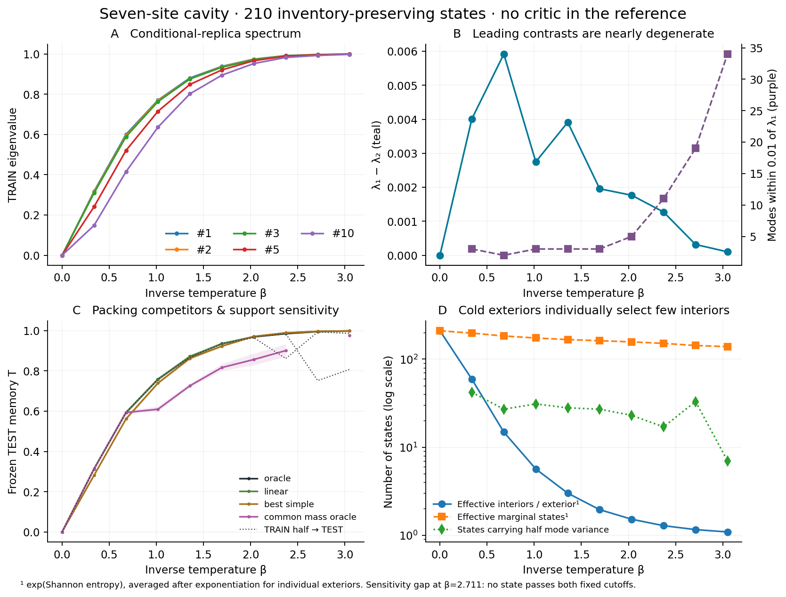
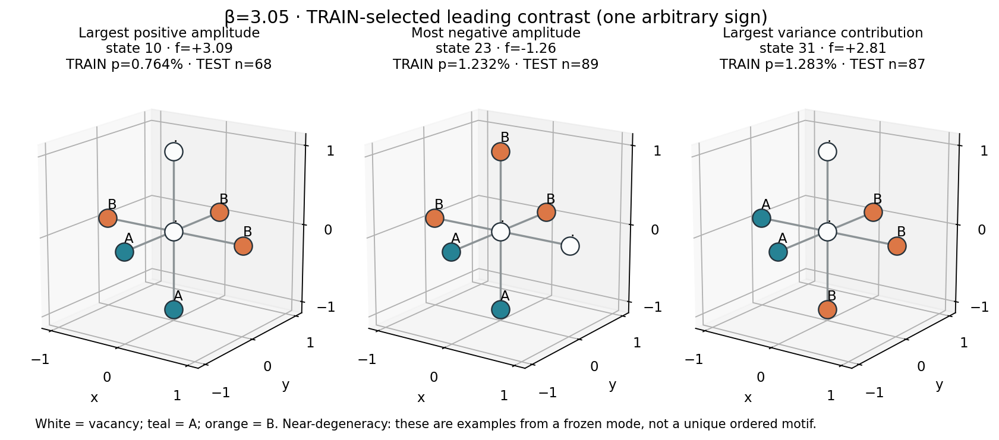
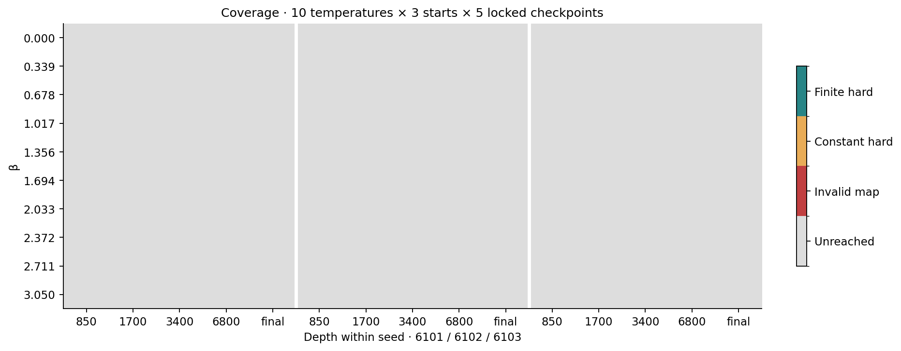

# 03 · What does a seven-site glass cavity remember?

**At β=3.05, asking just “is the center vacant?” recovers the held-out memory of the leading 210-state mode to within one part in a thousand.** The strong result is for an inventory-matched cavity in direct contact with its frozen exterior. It does not establish a bulk order parameter or long-range memory. The stock-learning comparison is **not measured** in the original dispatch: all workers failed while constructing their inputs, before the first optimizer update.

| Frozen observable, β=3.05 | TEST memory T | Pointwise 95% parent interval |
|---|---:|---:|
| Leading unrestricted TRAIN mode | 0.998536 | 0.997859–0.999214 |
| Center vacant | 0.998675 | 0.997966–0.999384 |
| Best linear combination of the 14 site/species indicators | 0.998399 | 0.997772–0.999026 |
| Unrestricted minus center vacant, paired | −0.000139 | −0.001012–0.000735 |
| Unrestricted minus linear, paired | +0.000137 | −0.000549–0.000823 |

**One contrast, not three confirmations.** In this sector the star has five occupied sites. If `n` is central occupancy, its six neighbors have exactly `m = 5 − n` occupied sites. For an occupied center `m = 4`; `(4−3)² = (4−5)² = 1` for A or B. For a vacant center its energy contribution is zero. Thus the central Hamiltonian penalty is **n**, center vacancy is **1−n**, and center coordination is **5−n**. Their centered observables differ by a sign at most; the variance ratio is invariant under affine rescaling. This identity is imposed by the chosen inventory, not an identity of the unconstrained glass. The independent evidence for memory is the reproducibility of that one variable between independent replicas sharing the exterior, not the agreement between its three names.

## Which configurations carry it?

At β=3.05 the TRAIN leading eigenvalue is 0.999447, the first gap is only 0.000101, and 34 modes lie within 0.01 of the leader. Both extreme signed patterns pictured have a vacant center. The leading vector is **not uniquely “the vacancy mode”**; rather, a much simpler observable attains essentially the same held-parent memory. Seven states carrying 6.26% of the marginal mass carry half of this mode’s variance; it does not trigger the registered ≤1% rare-localization flag. No unique collective motif is identified. The two IID replicas match in all seven labeled sites with exact TRAIN probability 0.95977 at β=3.05, versus 1/210 at β=0. That collision probability and the normalized memory T are different statistics.

## How the physical answer was obtained

- L20 archive, all ten temperatures, all 163,840 original parent identities scanned. Fixed 8,192/8,192 TRAIN/TEST at each β. Each parent had the same 216 disjoint candidate stars with a keyed translation and ordering. Each eligible parent contributed **one** uniformly chosen matching star. TRAIN: 1,325,336 eligible windows → 81,909 parents. TEST: 1,325,535 → 81,913. The 18 parents without a match were retained in the census, not filled with an incompatible sector. TEST is held out from this calculation’s fits, not a virgin archive.
- Enumerated the 210 interior arrangements (2 vacancies, 2 A, 3 B), including changes to occupied *exterior* neighbors’ energy. For 20 wrapping exteriors, all 4,200 full-lattice energy differences matched exactly. All 48 cubic relabelings matched on each. At β=0 every row is uniform: zero between-exterior variance for every nonconstant observable. There is no nonzero reference by which to divide at β=0.
- For a scalar `f`, `T = Var_B(E[f | B]) / Var(f)` equals the normalized covariance of two independently redrawn interiors given the same exterior. The exact enumeration supplies the expectations without Monte Carlo error on these boundaries. TRAIN fixed the eigenvectors and competitors; TEST evaluated those fixed functions with paired parent-level uncertainty. A test fraction may exceed 1 because the reference was not maximized on TEST. Intervals do not include retraining uncertainty; [alternating TRAIN halves](train-halves.csv) show sensitivity to estimation. The restricted mass/ESS sensitivity at β=2.711 is unestimable: zero states pass both cutoffs, which were not relaxed.
- As in [Gökmen et al.](https://doi.org/10.1103/PhysRevLett.127.240603), a learned coarse variable needs a physical interpretation; its training bound is not the observable above. Unlike [variable-size pinned cavities](https://doi.org/10.1038/nphys1050), a single touching shell here cannot identify a length scale.

## Stock training: original dispatch failed before fitting

30 scheduled fits (ten β × seeds 6101–6103), 0 optimizer updates, 0 trained encoders, 0/150 checkpoints. `sb-OTABmGqOuJ1xBdTv3QvDjO`, one NVIDIA H100 80GB. A NumPy indexing mistake in the launcher tried to assign `(210,7,2)` into `(7,210,2)`. It did not reach `train_RSMI_optimiser`. This is neither numerical divergence of the critic nor a collapsed operator. **The fraction of memory captured by stock RSMI is unknown.** No replacement estimator, smaller fit or paid retry. The input packing fix was checked locally on all 210 states, both species, all seven locations and all 20 off-star sites. The stock library was not changed. Device resource charge **$0.30778263**, 236.0 H100-equivalent seconds including setup; cumulative $5.97851960, $19.02148040 remaining. 04 not started.

## Reuse without a simulator

- [Frozen preregistration](design.json) · [roster/anchor census, distribution and energy checks](parent-census.json) · [exact-stage receipt](exact-receipt.json) · [ledger](billing.json) · [launch reservation](reservation.json) · [checkpoint coverage](coverage.csv).
- [All parent banks, exact integer relative energies, observed interiors, sufficient exterior data, TRAIN replica pairs and geometry](exact-exteriors-and-replicas.zip). `prepared.json` pins the constituent hashes. Per side `all_ids` and `native_rows` cover the full roster; `selected` indexes it; `anchor`, `observed`, `relative_E`, `fc`, `su` and `fu` follow selected-parent order. `fc`/`fu` count occupied neighbors outside the cavity, `su` gives the neighboring exterior species. `state-geometry.npz` fixes site and state order. Pairs are IID conditional draws with equal weight, 16 per contributing TRAIN parent; matching draws are allowed. Stock’s finite shuffle buffer does not guarantee distinct-parent negatives.
- [Benchmark and paired uncertainties](benchmark.csv) · [spectrum](spectrum.csv) · [per-state probabilities, amplitudes and frequencies](state-support.csv) · [all frozen mode weights](frozen-modes.npz). Numbers and PNGs are reproducible from the published banks using `examples/stock_glass_cavity_memory.py` and `examples/stock_glass_cavity_gallery.py`.
