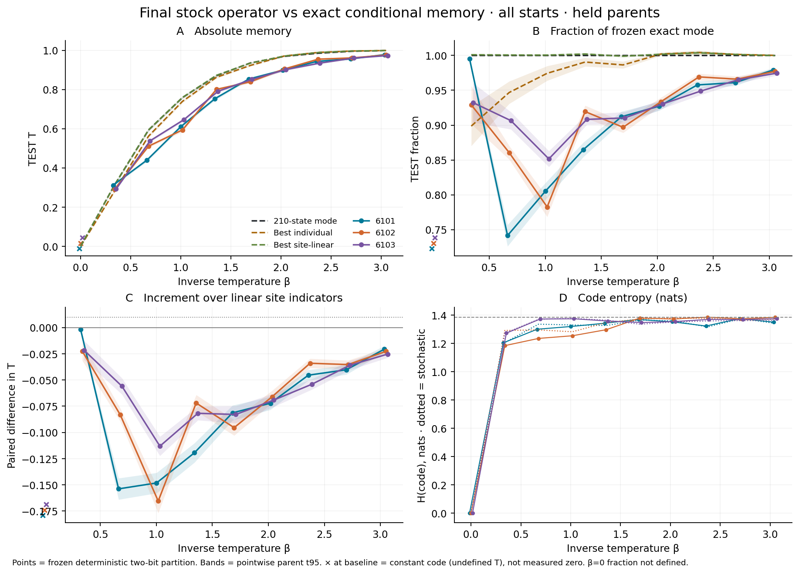
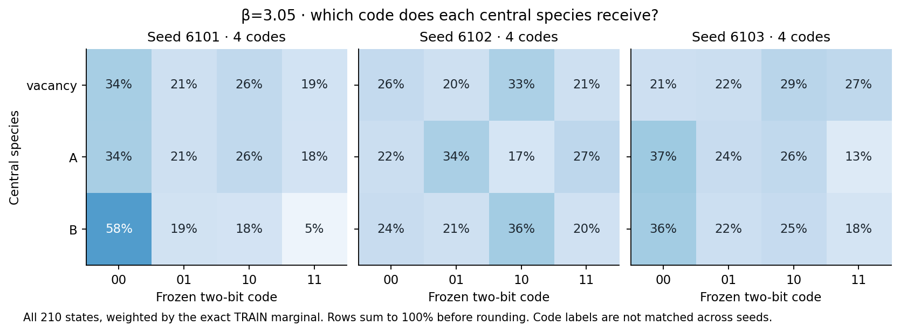
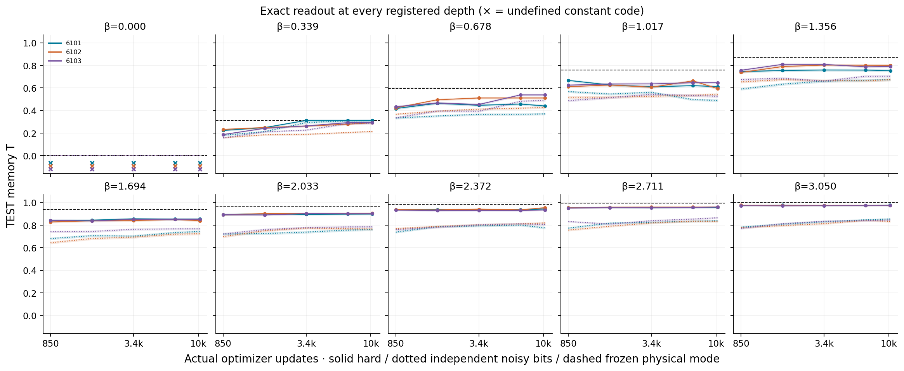
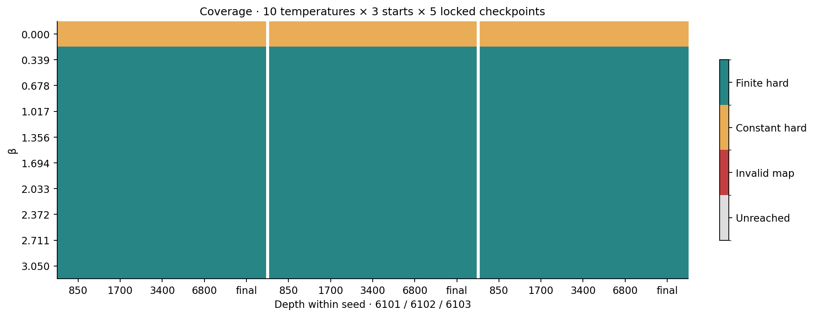

# 03 · Stock RSMI on independent replicas of the same cavity

**The learned two-bit operators remember the cold cavity, but do not beat “is the center vacant?”** At β=3.05 the three deterministic hard codes capture **97.46–97.92%** of the held-out memory of the frozen 210-state mode. Their memory is **2.09–2.55 percentage points below** the vacancy indicator on the same 8,187 TEST exteriors. This is a fraction of a *variance ratio*, not a fraction of the mutual information.

| β=3.05, frozen observable | TEST memory T (95% parent interval) | Fraction of reference (95% parent interval) | Paired difference from center vacancy (95% parent interval) |
|---|---:|---:|---:|
| Center vacancy | 0.99868 (0.99797, 0.99938) | 1.00014 (0.99926, 1.00101) | — |
| TRAIN-selected 210-state contrast | 0.99854 (0.99786, 0.99921) | 1 by definition | −0.00014 (−0.00101, +0.00074) |
| Hard · 6101 | 0.97779 (0.97458, 0.98101) | 0.97923 (0.97601, 0.98245) | −0.02088 (−0.02407, −0.01769) |
| Hard · 6102 | 0.97571 (0.97251, 0.97890) | 0.97714 (0.97393, 0.98034) | −0.02297 (−0.02617, −0.01977) |
| Hard · 6103 | 0.97313 (0.96969, 0.97657) | 0.97455 (0.97112, 0.97799) | −0.02555 (−0.02901, −0.02209) |

**Registered decisions:** useful cold recovery **passes** in all three independent starts (lower 95% T > 0.05 and lower 95% fraction > 0.5). Improvement beyond site-linear packing **fails** in all three: each upper limit is negative, not merely below the +0.01 margin. Even unrestricted minus site-linear is +0.00014 (−0.00055, +0.00082). These contrasts were fitted on TRAIN and scored unchanged on TEST; no depth or seed was selected on TEST. Intervals measure uncertainty across independent TEST parents for a fixed fit; the seeds show optimizer variability separately. TEST was used by other archived studies.



## What did the encoder learn?

A reproducible *level of memory* is not a unique microscopic rule. At the cold endpoint, all three encoders use four hard categories (entropy 1.350–1.385 nats, maximum log 4). Their scalar contrasts have absolute correlations of only 0.010, 0.056 and 0.158 with center vacancy. The exterior so strongly constrains the interior that many different partitions are memorable: two independent draws agree on the entire seven-site arrangement with probability 0.960 on the cold TRAIN exteriors. The central vacancy is a stronger, simpler benchmark; it is not a claim that the networks encoded that particular bit. Center coordination and the central Hamiltonian penalty are affine versions of the same vacancy observable **only in this fixed inventory**, not independent successes.



The stochastic code uses fresh, independent noise for each replica. At β=3.05 its memory is **0.855, 0.833, 0.845** (seeds 6101–6103), below the signed pre-noise partition. At β=0 the exact interior law is identical on every boundary; all nonconstant observables have exactly zero memory. The final hard codes there are constant in all three starts, so their T is **undefined**, not measured zero; even their stochastic bits have zero boundary memory. No hot fraction is defined. No InfoNCE value was substituted for this test.



## Execution and data

- Same [frozen experiment](../design.json) and [exact reference](../). All 163,840 archive parents scanned. Condition matched at a registered origin for 81,909 TRAIN / 81,913 TEST parents. Every eligible TRAIN parent contributed 16 pairs, every training epoch included the final short batch. TEST data were not sent to the H100. At β=3.05: 8,185 fit parents, final batch 460.
- One corrective H100, `sb-M2Bar8OLx4Hf58xtVxkItc`. First registered fit β=0/6101 ran alone; measured stock Adam step 1 on the actual 131,072-pair bank, then 10,257/10,257 updates. Its saved checkpoint and device/bank receipt gated the other 29. No extra pilot fit. **30/30 complete, 150/150 finite checkpoints, 307,593 actual optimizer updates**, 153,333,648 presentations including repeated epochs. The 27 fits at indices 0–8 reached 10,257; the three at index 9 reached 10,218.
- State maps use the saved, unmodified stock H100 logits. All 150 checkpoints independently reproduced their contractions from the weights with TF32-rounded operands (maximum absolute replay error 0.00000167). Three bit comparisons across the checkpoints would differ if recomputed with unrounded weights instead. The saved logits determine the partition throughout.
- **Charges:** failed original $0.30778263 + corrective $1.02825615 = **$1.33603878** for 03. Cumulative $7.00677575, **$17.99322425 remains**. Both sandboxes terminated. No new bulk configurations, trajectories or experiment 04.



**Source data:** [paired physical readouts, rates and intervals](frozen-readout.csv) · [coverage and precision checks](coverage.csv) · [all state→code maps, contrasts and relaxed moments](code-maps.npz) · [all stock encoder/critic checkpoints and raw arrays](stock-checkpoints.zip) · [TRAIN-only traces](train-trace.csv) · [first update per fit and SHA-256 pins](first-updates.json) · [terminal fit receipts](fit-receipts.json) · [both costs](billing.json) · [original failures](../dispatch-trace.txt).

To reproduce the readout without a GPU: extract `../exact-exteriors-and-replicas.zip` to `BANKS`, extract `stock-checkpoints.zip` to `FITS`, create `OUT`, and run from the repo root:

```sh
ref=results/experiment-03-cavity
OPENBLAS_NUM_THREADS=1 python3 examples/stock_glass_cavity_readout.py --inputs BANKS --runs FITS --reference "$ref" --out OUT
python3 examples/stock_glass_cavity_gallery.py OUT --reference "$ref"
```
