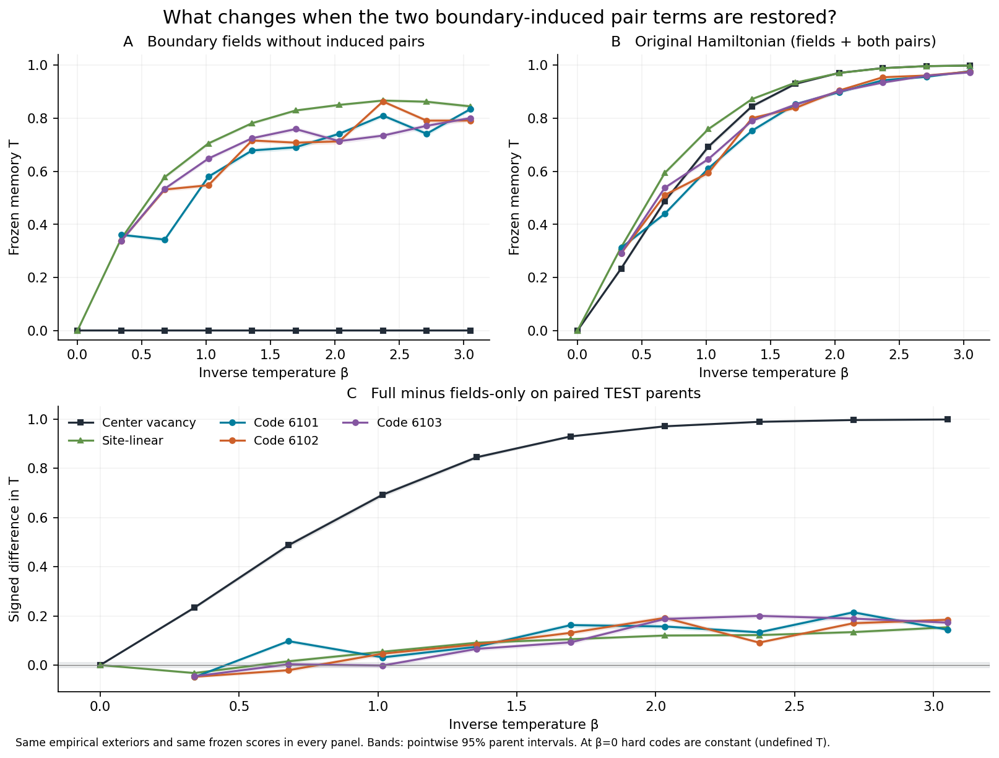
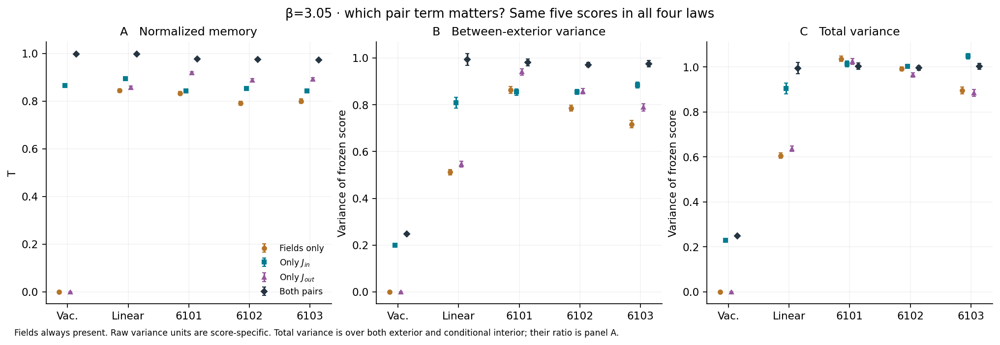
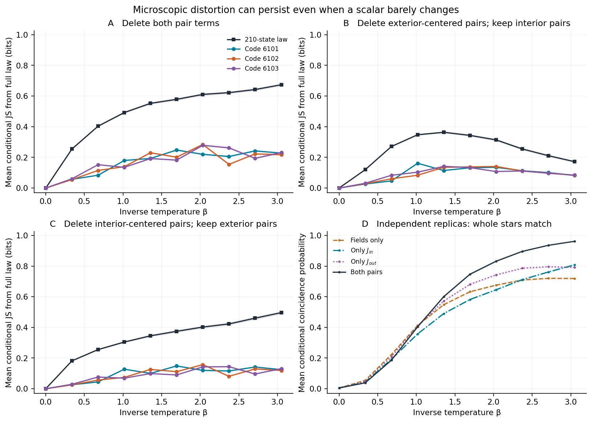
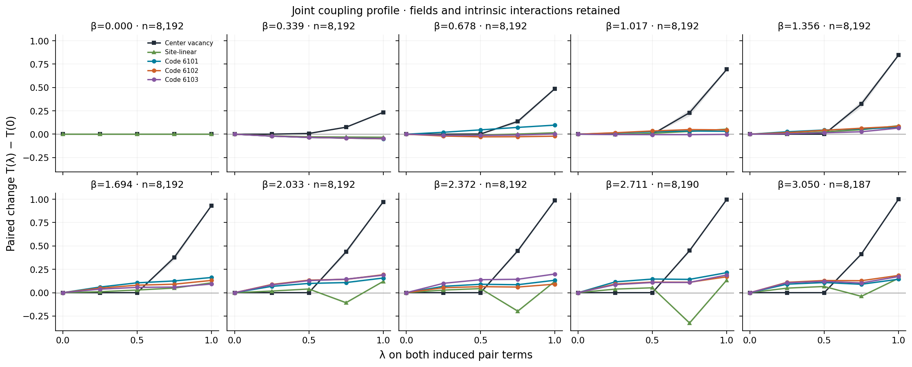

# 04 · Do the frozen glass codes remember fields or boundary-induced interactions?

**Both.** On the same 8,187 cold TEST exteriors, the three stock codes retain substantial memory with boundary fields alone (`T = 0.791–0.834`). Restoring both induced pair terms raises each frozen code’s memory by **0.144–0.184**. All three paired 95% intervals lie above the preregistered +0.01 practical margin. This is a change in the memory of the *same* operator on the *same* parents, not a change in neural-network performance after refitting.

| Frozen observable, β=3.05 | Fields only | Full Hamiltonian | Full minus fields (paired 95% parent interval) |
|---|---:|---:|---:|
| Center vacant | ≈0 | 0.998675 | +0.998675 (0.997966, 0.999384) |
| Best 03 site-linear contrast | 0.844859 | 0.998399 | +0.153540 (0.146093, 0.160987) |
| Hard code · 6101 | 0.833774 | 0.977792 | +0.144018 (0.136300, 0.151737) |
| Hard code · 6102 | 0.791393 | 0.975707 | +0.184314 (0.175806, 0.192822) |
| Hard code · 6103 | 0.800565 | 0.973128 | +0.172562 (0.163433, 0.181692) |



## The center vacancy distinguishes the two couplings

With fields alone, almost every interior has an **occupied** center: the exact mean vacancy probability on these exteriors is `2.08e−31`, versus **45.69%** under the full law. The fields-only between-exterior variance of the vacancy indicator is `8.60e−59` and its total variance `2.08e−31`; its tiny T is not a new constant-code convention. Under the full law those variances are **0.247815** and **0.248144**. The coupling changes which central occupations are available in practice, not just the normalization of a correlation.

- **Interior-centered term only** (omit exterior-centered pairs): vacancy memory is **0.8661**. In this star the center has no exterior neighbors, and each arm has only the center as a cavity neighbor. Thus `J_in = 2 n_center Σ_arm n_i d_i`: it charges an occupied center according to its occupied arms and their exterior coordination; it vanishes for a vacant center.
- **Exterior-centered term only** (omit interior-centered pairs): vacancy memory is **6.94e−36**. This term charges occupied perpendicular arms that meet the same occupied exterior site. It is not a substitute for the center–arm coupling. Adding it *with* the interior term present raises vacancy memory a further **0.1326** (paired 95% interval 0.1261–0.1391).
- **The codes respond differently from the central bit.** Starting from the full law, removing the exterior-centered term reduces code memory by **0.123–0.135**; removing the interior-centered term reduces it by **0.059–0.087**. Yet removing the interior-centered term displaces the *whole 210-state law* more. There is no additive “percentage due to each interaction”: these are comparisons of specified Hamiltonians, and the ratio’s numerator and denominator both change.



## A memorable code does not imply unchanged interiors

At β=3.05 the fields-only and full state laws differ by **0.674 bits** of mean per-exterior Jensen–Shannon divergence (95% interval **0.664–0.683**). After projection onto the frozen four-label codes this is **0.228, 0.217, 0.232 bits**, respectively. Deleting only the interior-centered term gives state divergence **0.496 bits**, versus **0.172 bits** when deleting only the exterior-centered term. These are divergences between two conditional laws, **not mutual information captured by the encoder**. The probability that two independent interior draws match on all seven sites rises from **0.719 to 0.962** on restoring both terms (paired change +0.243, interval 0.236–0.250).



The joint-strength profile is descriptive, not a monotonicity claim: for example, cold seed 6103 has `T = 0.801, 0.907, 0.922, 0.905, 0.973` at the five fixed strengths. At β=0 every law is uniform. Nonconstant observables then have T=0; the three frozen hard codes are constant, so their T and signed differences are **undefined**, not zero. Each temperature retains its own 03 fit; only the intervention within a temperature compares literally the same trained function.



## What was held fixed

We kept the 03 matched-inventory, direct-contact ensemble: two vacancies, two A and three B on a labeled seven-site star. All parents keep their original eligibility, exterior and weight. The empty exterior defines the **energy reference**, not the distribution of boundaries. With `s_i` occupied interior neighbors, `d_i` occupied exterior neighbors, and `D_u` the occupied cavity neighbors of exterior site `u`, the four terms, up to state-independent constants, are:

- `H0 = Σ_i n_i(s_i−ℓ_i)²` (intrinsic; kept in **every** law);
- `U = Σ_i n_i(d_i²−2 d_i ℓ_i) + Σ_u n_u[2(a_u−ℓ_u)+1]D_u`, with `a_u` the occupied exterior neighbors of `u`;
- `J_in = 2 Σ_i n_i d_i s_i` and `J_out = Σ_u n_u D_u(D_u−1)`.

Thus “fields only” means `H0+U`, **not a noninteracting cavity**. We enumerate normalized Boltzmann weights at fixed empirical exteriors for `H0` alone, both single-term restorations on `H0+U`, and the five joint strengths. No exterior was re-equilibrated under an altered Hamiltonian. The separation is defined by the empty-exterior convention, not a unique field gauge. It establishes a direct-contact mechanism in this sector, not a bulk transition or point-to-set length. [Nishikawa & Hukushima](https://doi.org/10.1103/PhysRevLett.125.065501) give the physical Hamiltonian. [Gökmen et al. on operators](https://doi.org/10.1103/PhysRevLett.127.240603) and [their estimator](https://doi.org/10.1103/PhysRevE.104.064106), and [Biroli et al. on frozen boundaries](https://doi.org/10.1038/nphys1050), motivate the question, not this intervention.

**Inference and coverage.** `T = Var_B(E[f|B])/Var(f)`. The hard category partition and its scalar contrast were trained in 03, frozen at the final checkpoint, and never reoptimized here. The same holds for the 03 site-linear comparator. The intervals propagate *paired whole-parent* influences, conditional on those fits; the three seeds are not three cohorts. All ten temperatures: 8,192 TEST parents at each of the first eight, 8,190 at β=2.711111, 8,187 at β=3.05; **81,913** total. Other temperatures and intermediate coupling strengths are descriptive. No new fit, sampling, trajectories or Modal charge. **$17.99322425 remains.** No 05.

## Verification and reproduction

- [Frozen preregistration](design.json) · [03 input archive and exact spectrum](../experiment-03-cavity/) · [published 03 final-code maps and contrasts](../experiment-03-cavity/corrected/) · [computation](../../examples/stock_glass_boundary_couplings.py) · [plotting](../../examples/stock_glass_boundary_figures.py).
- [Energy audit](energy-audit.csv): **34,402,620 / 34,402,620** integer differences exactly reproduced over both sides, all 210 states. Full-law conditional probabilities are identical to the archived construction. [Endpoint comparison](03-equality.csv): 130 frozen reference rows, four matching undefined cases; largest finite discrepancy (including interval endpoints) **5.02e−14**. [No-boundary and hot nulls](nulls.csv) · [audit receipt](audit.json).
- [Memory, both raw variance components, signed changes and intervals](memory.csv) · [state/code distortion and uncertainty](distortion.csv) · [data-processing audit](projection-audit.csv): no violations on 1,965,912 parent/partition comparisons · [measurement receipt](measurement.json) · [cold decisions](decision.json).
- [Per-parent endpoint data](parent-endpoints.npz): original TEST identities and anchors, conditional mean and second moment about the *ensemble* mean for each frozen scalar at the two endpoints, whole-state coincidence and per-parent JS in bits. Numerically undefined constant codes have zero available variance and `NaN` T in the CSV. All intermediate laws are reproducible from the archived sufficient exterior counts.

Extract the original `exact-exteriors-and-replicas.zip` into `BANKS`, then from the repo root:

```sh
export OPENBLAS_NUM_THREADS=1 OMP_NUM_THREADS=1
python3 examples/stock_glass_boundary_couplings.py audit --banks BANKS
python3 examples/stock_glass_boundary_couplings.py measure --banks BANKS
python3 examples/stock_glass_boundary_figures.py results/experiment-04-boundary-couplings
```
