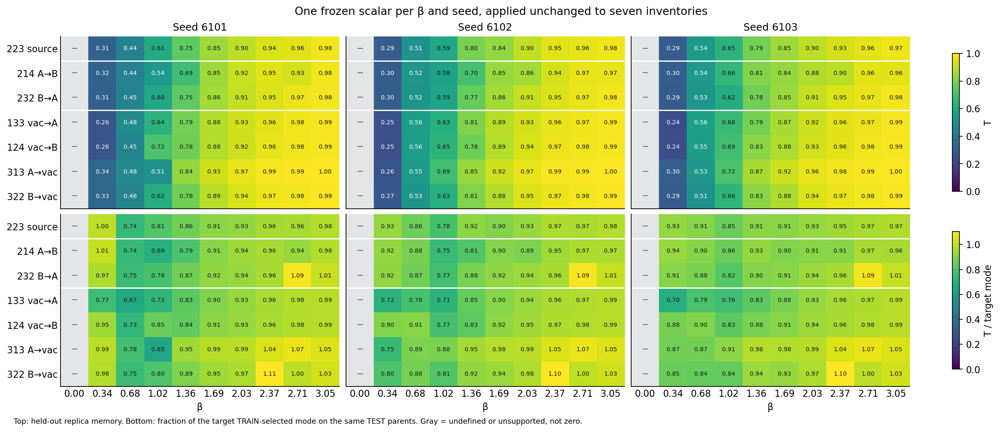
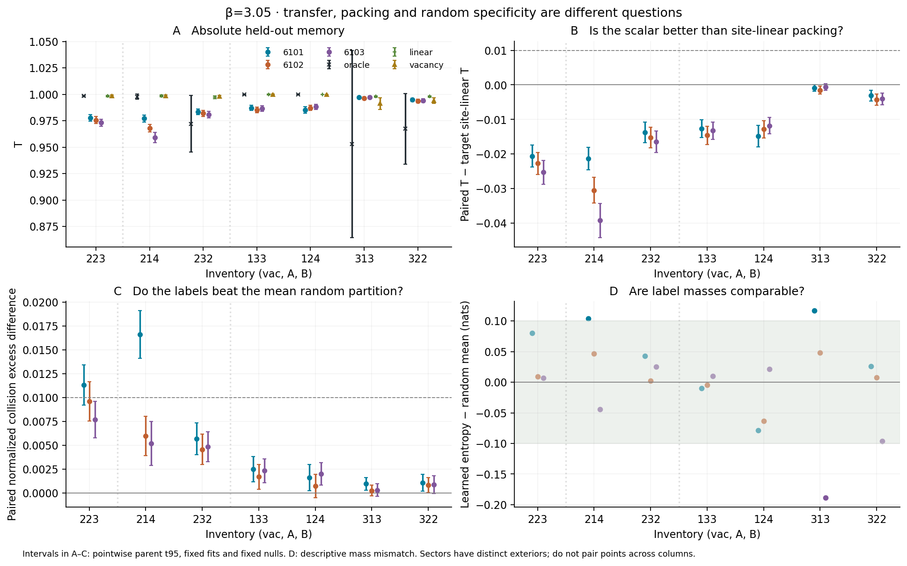
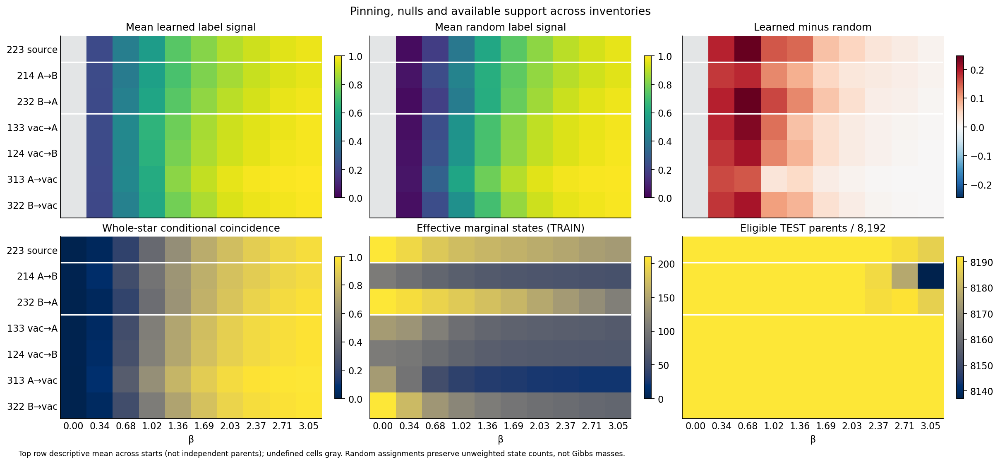
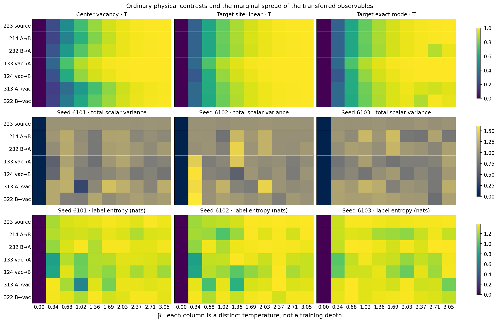

# 05 · Does the same stock RSMI operator transfer to neighboring inventories?

**Yes for memory; no consistent cold advantage over ordinary packing or arbitrary partitions.** At β=3.05 the 03 kernels **and their scalar readout coefficients**, unchanged, pass the registered transfer test in **all six neighboring sectors, for all three seeds**. Across the 18 target fits/readouts the lowest held-parent memory is **0.95921** (95% interval **0.95427–0.96414**). But the target’s site-linear observable has a higher point estimate in all 18 comparisons. Within each target, two independent draws already agree on the *entire seven-site arrangement* 95.4–99.6% of the time. High cold memory alone does not select a privileged neural partition.

## Six separate cold decisions

Inventory digits are **(vacancies, A, B)**. Each memory range below spans the three seeds; it is **not** a confidence interval. The penultimate column is the smallest of the three lower 95% parent bounds for `T / target exact mode`. The registered floors were lower `T > 0.05` and lower fraction `> 0.5` for **every** seed. Each comparison uses that target’s TEST exteriors; comparisons *between* inventories are marginal, not matched-star contrasts.

| Target | Change from 223 | TEST parents | Frozen scalar T | Target site-linear T | Lowest fraction lower bound | Verdict |
|---|---|---:|---:|---:|---:|---|
| 214 | A→B, same occupancy | 8,137 | 0.95921–0.97711 | 0.99840 | 0.95603 | Transfers |
| 232 | B→A, same occupancy | 8,187 | 0.98089–0.98356 | 0.99730 | 0.98114 | Transfers |
| 133 | vacancy→A | 8,192 | 0.98524–0.98719 | 0.99982 | 0.98284 | Transfers |
| 124 | vacancy→B | 8,192 | 0.98514–0.98817 | 0.99996 | 0.98207 | Transfers |
| 313 | A→vacancy | 8,192 | 0.99645–0.99732 | 0.99794 | 0.94835 | Transfers |
| 322 | B→vacancy | 8,192 | 0.99367–0.99487 | 0.99799 | 0.99172 | Transfers |

Source **223**: T=0.97313–0.97779 on 8,187 TEST parents, site-linear 0.99840. [Every seed, absolute/fraction intervals and paired differences](frozen-scores.csv) · [six decisions plus source check](cold-decisions.csv).



## How much is specific to the code?

We asked two different questions. For scalar transfer, `T = Var_B E[f|B] / Var(f)` uses the literal *source* scalar `f`. For categorical specificity, `p_B(h)` is the probability of frozen label `h` on boundary `B`; `S = Σ_h Var_B p_B(h)` is the excess probability of label agreement between independent replicas of the **same** exterior versus independent exteriors. We normalize by `D = 1 − Σ_h mean_B(p_B(h))²`. This readout uses no scalar coefficients and is invariant to relabeling. It is neither InfoNCE nor scalar T.

Each frozen partition faced 64 fixed random permutations of the state→label assignment. They preserve **numbers of enumerated states** per label, not equilibrium probabilities. The comparison uses the paired true-minus-mean-null score on the same parents. The range across 64 assignments describes partition variation; it does not multiply the statistical sample size.

- **Packing:** No cold target cleared the registered +0.01 scalar advantage over its site-linear comparator. In 313, two seed-specific intervals on the difference include zero; this is not evidence of an improvement.
- **Random partitions:** All 18 cold target point differences in normalized categorical signal were positive; 14 individual pointwise lower bounds exceeded zero, but **only one** exceeded +0.01. **No sector** cleared that practical margin for all three starts. The one case (214, seed 6101: +0.01662, interval +0.01411 to +0.01913) also differed from the null mean label entropy by +0.104 nat. Marked entropy mismatches also occurred for two starts in 313. Do not call the null entropy-matched or infer a unique ML advantage.
- **Away from the cold endpoint:** The median learned-minus-random difference over the 18 target cells was +0.209 at β=0.678 versus +0.00187 at β=3.05. This descriptive contrast is consistent with the arbitrary partitions running out of headroom as pinning increases. These are temperature-specific source fits and empirical ensembles, **not** unseen-temperature transfer or 18 independent temperature measurements.





## Why some fractions exceed one

“Exact mode” means exact conditional probabilities and a full supported state basis, **not** an oracle fitted on TEST. A TRAIN-selected high-amplitude contrast can put weight on rare states. In cold **313**, only 0.0244% of TRAIN marginal mass carries half the leading mode variance. Its frozen TEST T is **0.95316** (pointwise interval 0.86465–1.04166; the delta-method interval is not clipped to the physical bounds). The prespecified common-support comparator gives **0.99889** on the same target. In **232** and **322** the common-support comparator also exceeds the unrestricted TRAIN-selected mode on TEST. A ratio over one is consequently possible, not super-optimal learning. The six decisions above use the original reference; none substitutes the sensitivity result.

All cold target scalar variances were at least **0.745** in their source units; no cold transfer depended on a near-constant target scalar. The cold target categorical denominators ranged from **0.636 to 0.746**. At β=0 the exact interior distribution is uniform in each sector, independent of exterior, so every nonconstant observable has zero memory. The actual three hard codes there are constant on all seven sectors: unnormalized excess agreement is zero, normalized signal and scalar T **undefined**. No arbitrary scalar coefficient was used to manufacture a result. [Per-state masses, empirical counts and exterior-weight ESS](states.csv) · [support/gaps/collisions](support.csv) · [sensitivity and ordinary reference intervals](ordinary.csv).



## Provenance, sampling and uncertainty

- [Preregistration](design.json), published before target scoring. Exact full physical Hamiltonian, not experiment 04’s perturbations. Source: [03 final stock H100 checkpoints, trained coefficients and receipts](../experiment-03-cavity/corrected/). Reused all 30 final kernels: 10 β × seeds 6101/6102/6103; depth 10,257 for indices 0–8, 10,218 for index 9. No fit, network modification, MCMC, new physical snapshot, H100 or Modal charge. **$17.99322425 remains.**
- Identical 3D star embedding/order and numerical contraction as 03. Source replay: **6,300/6,300 state-label assignments** identical; final source logits also agreed exactly. The 03 `>=0` rule, label order, and source four-label scalar were kept. Checked source category mass, covariance rank, coefficient identifiability and target sign resolution. All positive-β source readouts had all four coefficients supported. [Per-fit checkpoint/coefficients](source-replay.csv) · [all-sector sign audit](sign-audit.csv) · [transferred labels, source masses and coefficients](frozen-transfer.npz) · [source readout equality](source-equality.csv).
- All **163,840** original L20 IDs, exactly 8,192 TRAIN and 8,192 TEST per temperature. Replayed each parent’s identical 216 species-blind ordered disjoint origins. First anchor matching the **observed** inventory in each sector; no substitutes. Source selected parents, positions, sufficient boundary statistics and integer energies match 03 on all **163,822** contributing source rows. Target full-lattice checks used wrapping stars on both sides at all temperatures: **22,400** state energy differences over **140** sector/side/temperature cases including source, zero mismatches. [Coverage, eligible origins and missing parents](coverage.csv) · [full integer audit and file pins](bank-receipt.json).
- Uncertainty is across held-out whole parents for a fixed fit, not across sites, starts, or permutations. Scalar-to-baseline and real-to-random comparisons are paired within each target. Many of the **same** parents qualify in multiple sectors but contribute **different stars and exteriors**. We neither pool sectors nor use the number of parent-sector combinations as an independent sample size. TEST is held out from the fits here, not a previously untouched archive. This is about a directly touching seven-site cavity, not a growing length or a glass transition.

### Reuse without simulation or training

Unzip [neighboring exterior banks](target-exteriors.zip) into `TARGET` and the [03 exact banks](../experiment-03-cavity/exact-exteriors-and-replicas.zip) into `SOURCE`. Each target file gives counts for the full 8,192-member side, `selected` indices into that side’s 03 `all_ids`, periodic anchors, observed state and exterior sufficient counts. State strings are listed in [states.csv](states.csv). The [bank adapter](../../examples/stock_glass_inventory_banks.py) can also rebuild the archive from native snapshots. From the repository root, reproduce the scores and figures locally:

```sh
OPENBLAS_NUM_THREADS=2 python3 examples/stock_glass_inventory_transfer.py --source-banks SOURCE --banks TARGET
OPENBLAS_NUM_THREADS=1 python3 examples/stock_glass_inventory_figures.py
```

[Exact categorical components and paired parent uncertainty](categorical.csv) · [all 13,440 random-partition rows with null masses, entropy and uncertainty](random-partitions.csv) · [target TRAIN-selected scalar comparators](target-comparators.npz) · [scoring source](../../examples/stock_glass_inventory_transfer.py) · [plot source](../../examples/stock_glass_inventory_figures.py).

**References.** [Nishikawa & Hukushima](https://doi.org/10.1103/PhysRevLett.125.065501) for the glass Hamiltonian; [Gökmen et al.](https://doi.org/10.1103/PhysRevLett.127.240603) and [their estimator paper](https://doi.org/10.1103/PhysRevE.104.064106) for learning and interpreting coarse variables; **Sho Yaida, Ludovic Berthier, Patrick Charbonneau & Gilles Tarjus**, [*Point-to-set lengths, local structure, and glassiness*, arXiv:1511.03573](https://arxiv.org/abs/1511.03573) for generalized observable-dependent PTS. This inventory-transfer experiment is our diagnostic, not one performed by those papers.
