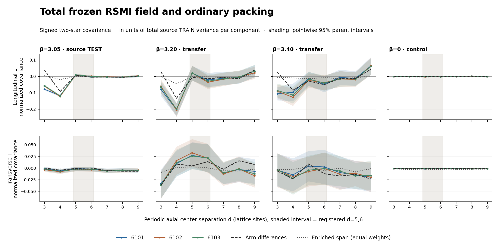
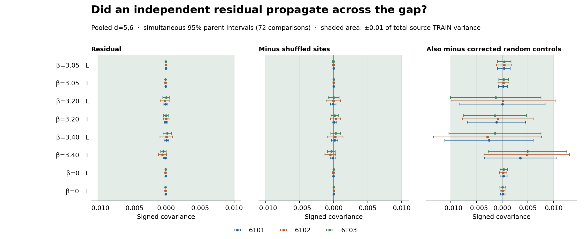

# What propagates in the frozen RSMI field?

**The three stock encoders learned a reproducible short-range packing pattern. None showed a distinct polar field propagating across the registered gap at the 1% scale.** This is a result about actual neural filters: no hand-built opening observable, new trainer, dynamics, or GPU was used.

At center separation **d=4**, all three total learned fields had negative longitudinal covariance on held β=3.05 (−0.122 to −0.117), β=3.20 (−0.205 to −0.199), and β=3.40 (−0.127 to −0.097). The β=0 estimates were within 0.00006 of zero there. An elementary field—the difference in species occupancy on opposite arms of a star—had the same dip (−0.093, −0.133, −0.084). This is a descriptive feature, not the discovery endpoint: at d=4 the nearest sites of the two stars are still only two lattice spacings apart. It is a physically interpretable feature the network learned, not a new glass order parameter.



### The registered test beyond direct interaction reach

We pooled center separations **5 and 6** with equal weight: minimum separations between star sites are 3 and 4, beyond a Hamiltonian term's diameter of 2. We projected out ordinary directional packing on source TRAIN only. At fixed direction we computed covariance on *jointly eligible pairs*, subtracting separate means at the two endpoints. Longitudinal (L) uses the component along the separation; transverse (T) averages the other two. Every parent has one vote. A parent without at least two pairs in **every** required axis and distance was recorded as unsupported, never filled with zero.

| Cohort | Scored parents | Parents supporting pooled d=5,6 | Smallest axis/d pair count among contributors | Enriched residual covariance: envelope of simultaneous 95% intervals over all three seeds and L/T |
|---|---:|---:|---:|---:|
| β=3.05 source TRAIN (normalization, descriptive) | 8,192 | 8,027 | 64,708 | — |
| β=3.05 held source | 4,096 | 4,024 | 32,582 | [−0.000171, +0.000088] |
| β=3.20 frozen transfer | 128 | 122 | 811 | [−0.000859, +0.000545] |
| β=3.40 frozen transfer | 128 | 112 | 640 | [−0.001118, +0.000997] |
| β=0 canonical control | 4,096 | 4,096 | 379,708 | [−0.000182, −0.000002] |

Envelopes rounded outward. These are **signed covariance units per unit of total source TRAIN component variance**, not nats or fractions of residual variance. The most extreme absolute endpoint for a learned residual at the three physical temperatures was **0.0011171** versus the preregistered meaningful magnitude **0.01**. Subtracting the within-parent shuffled-label control left all those intervals within ±0.00136. The small raw negative bias in the β=0 control is a reason not to interpret departure from exact zero as discovery; its six shuffle-corrected intervals include zero. No sign, seed, temperature or distance was selected on held data. The direct residual is measured considerably more precisely than the comparison against random partitions.



### What the conventional explanation covers

The operators are the three original β=3.05, 10,218-update [03 checkpoints](../experiment-03-cavity/corrected/), not newly fit proxies. All weights replayed the archived float32 logits and categorical assignments byte-for-byte on all 210 allowable seven-site configurations. For one-hot label a, the matrix units are F_iak(s)=(3/48) Σ_g R_ik(g) 1[label(g⁻¹s)=a]. We trace matching copies (a,k) rather than inventing a unique vector in the 48-dimensional T1u isotypic space. All 48 cubic actions passed exact equivariance; maximum TRAIN isotropy error 1.67×10⁻¹⁶. No labels or zeros were assigned to off-sector stars in scoring. [Map replay](map-lock.json) · [vector construction](mapping-receipt.json) · [actual frozen field tables](fields.npz).

| Stock seed | Raw total TRAIN variance/component | Raw after packing | Fraction remaining | Selected null minus learned T1u power |
|---|---:|---:|---:|---:|
| 6101 | 0.347894 | 0.002983 | 0.857% | −0.151 |
| 6102 | 0.312748 | 0.005519 | 1.765% | −0.110 |
| 6103 | 0.388409 | 0.005185 | 1.335% | −0.216 |

Basic opposite-arm differences alone left 14.0–17.4% of total variance. Adding central species, counts of opposite-arm pair classes and signed same-axis pair contrasts reduced the remainder to the levels above. The rank-11 enriched ordinary vector span was fixed before measuring any correlations. The black enriched comparator in the total-curves figure equally weights its independent packing directions; its trace is **not** the seed-specific fitted projection. Covariances are not additive without cross terms. The [distance table](distance-curves.csv.gz) includes signed effects, shuffled values and uncertainty both on the original total scale and divided by each field's own remaining TRAIN variance. Dividing by tiny residual variance does not increase the physical magnitude.

**Limits on specificity.** Seed 6101 missed the predeclared 1% remaining-variance floor. For every seed, the 8 closest of its 64 fixed label shuffles matched entropy within the caliper but missed T1u power by more than 0.10. All controls and their IDs are reported; none was replaced. For the paired residual-minus-corrected-random contrast, the largest interval half-width was 0.01051, just above the 0.01 precision target. Thus a convincing learned-versus-matched-random ordering is **not identifiable by this control set**. This does not erase the tight direct bounds, and those bounds do not rule out nonlinear dependence, other symmetry sectors, an oscillatory signal that cancels across these two distances, or different operators. No correlation length or phase transition was fit. [TRAIN diagnostic](train-specificity.png) · [random matching](random-matching.csv) · [residual curves](residual-distance.png).

### Controls, coverage and reproduction

* [Design before outcomes](design.md), [synthetic control lock](pair-fixture-design.json), [measured qualification](pair-qualification.json), [scoring admission](admission.json). The same masked scorer recovered known weak L/T effects (+0.02295, −0.02306; analytic +0.02526, −0.02273). No iid or shuffled null promoted an effect; after subtraction the planted L lower limit +0.00959 did not itself clear +0.01. This is **not** an 80%-power guarantee. A mask-only counterexample gives −0.668 using a global mean, exactly zero with the required endpoint means.
* [72 simultaneous primary intervals](primary.csv) · [matched controls and paired differences](matched-comparisons.csv) · [eligible pair support](pair-support.csv) · [decision](decision.json) · [status](status.json). All 16,640 distinct input parents scored (7 CPU workers, 7.66 s in the scoring loop; staging, field construction, validation and plotting excluded). Controls use the same exact apertures. Raw site pairs are not independent samples. The [score receipt](score-receipt.json) pins the per-parent blocks and every cohort's inputs. `*-parent-primary.npz` contains uint64 identities, eligible counts, per-axis pair counts and both real and shuffled signed parent estimates for all 59 fields. No static Gate 2 reserve rows were scored. Source TEST is not a historically virgin archive; transfers are distinct nonlocal 500M preparation parents.
* From the checkout root, set `OPENBLAS_NUM_THREADS=1 OMP_NUM_THREADS=1`. `RUNS` is the native lattice-exploration runs directory, `STAGED` the hash-verified native `.npy` directory from the [opening study's input stage](../../examples/opening_inputs.py), and `SCRATCH` a distinct local work directory. Only nonreserve rows are decoded in this study. Commands below reproduce the study with the archived scientific pins; do not change the stock library:

```sh
python3 examples/field_distance_inputs.py source-train "$RUNS" "$STAGED" "$SCRATCH"
python3 examples/field_distance_maps.py
python3 examples/field_distance_pairs_qualify.py
python3 examples/field_distance_run.py "$RUNS" "$STAGED" "$SCRATCH" --workers 7
python3 examples/field_distance_inference.py "$SCRATCH"
python3 examples/field_distance_figures.py
```

**Decision: stop this frozen-field test.** The results support conventional directional packing as the dominant microscopic content of the learned polar fields, not a unique nonlocal field specific to RSMI. The motivation and literature—not an assumption of dimer universality—are in the [design](design.md).
