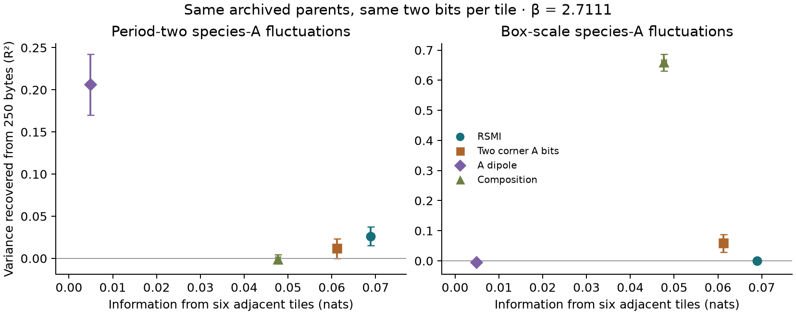
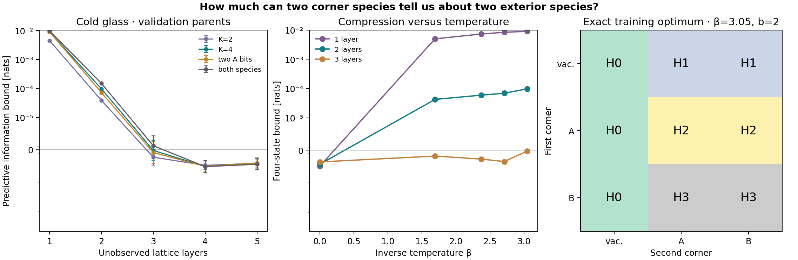

# Which information survives compression in the L20 lattice glass?

This experiment reuses the **frozen L20 endpoint archive**. It trains low-capacity discrete representations of local species blocks and asks what they predict about separated environments. No new physical configurations, dynamics or Monte Carlo runs are part of this campaign. The clock is **11:45:25–21:45:25 UTC on 24 November 2026**; it is a maximum elapsed-time allocation, not a claim about time actually spent training. See the [locked protocol](protocol.json) and the [previous short-range result](../l20-operators/README.md).

### Vacancy placement when all three pair shells tie

At β=2.3722, 86,539 nearest-neighbor edges on 512 validation parents had one particle, one vacancy, and identical exterior occupation counts in all three shells of squared distance 1, 2 and 3. Every homogeneous cubic vacancy-pair model restricted to those shells predicts equal placement odds. Integrating out A/B at fixed composition predicted the occupied end on **98.65%** of these opportunities; its forecast was **98.62%**, without fitting. Filling the end that brings neighbors to degrees 3 and 5 explains why equal pair energies need not mean equal probabilities. This predesignated primary concerns **local placement**, not distant cavity selection. [Mechanism and calibration](fifteen/pair-tie.png) · [15-row ledger with citations, negative results and power limits](fifteen/LEDGER.md).

### Why the vacancies themselves are now the target

With **no observed A/B labels**, the fixed-composition Hamiltonian predicts the mean energy and the outer-A probability for the oriented cage given the vacancy mask. At the [locked](https://github.com/konradha/RSMI-NE/commit/4b0868dd5c6c56a4492a68776cd4fe97f1b26a37) β=1.0167 validation, energy error was +0.000046 [−0.000145, +0.000238] per site and outer-A error was +0.0010 [−0.0214, +0.0233] percentage points. Both passed their separate tolerances. This integrates over all species placements, not just exchanges at fixed empirical species counts. [Mask predictions and energy variance](mask-oracle/mask-oracle.png). It does **not** explain why one vacancy arrangement rather than another occurs. The [preregistered cavity question](boundary/cavity-protocol.md) asks exactly that; no cavity replicas have been generated.

**The distant-shell predictor did not select the shape.** Compare a vacant tripod with a T-shaped set of vacancies at the same density and with exactly the same occupied-neighbor coordinations (3,3,5). At β=3.05, the radius-four boundary model scored 12,727 eligible centers from 1,024 held-out parents. Its AUC was **0.502**. The strongest conventional comparator selected on discovery parents was simply the class frequency. The paired gain was **0.0000043 nat per eligible center**, 95% [−0.0000124, +0.0000209], far below the locked 0.001 target. Crystal-template AUC was 0.508; that descriptive ranking is not evidence of a crystal. This limits the *tested predictor*, not all possible information in the shell. We froze [1,024 individual forecasts](boundary/issue-09.csv) and [512 disjoint comparisons](boundary/prospective-pairs.csv) before any cavity replicas. Their predicted probabilities span only 38.17–38.43%. **Do not commission the cavity run on this evidence.** [Figure](boundary/vacancy-selection.png) · [parent-level scores](boundary/score-09.json).

**It is local energy, not just geometric exclusion, that selects these shapes.** At β=2.3722, only 18.3% of matched centers had just one feasible shape. For the remaining centers, counting feasible orientations alone predicted the observed shape 61.0% of the time. Using the actual neighboring species and the Hamiltonian, with no fitted coefficients, predicted it **99.50% [99.41, 99.60]** of the time. An occupied arm changes the coordination energy of its neighbors; two perpendicular arms can also strain the same neighbor. Omitting that shared-neighbor cost lost 0.0468 [0.0416, 0.0521] nats per ambiguous center. At β=0 the energetic advantage was exactly zero. These predictions use the *near* halo (Manhattan radii 2–3); they do not predict an independently re-equilibrated cavity from its distant exterior. [Energy decomposition](boundary/near-cage.png) · [cohort and uncertainty](boundary/near-score-07.json) · [two of the issued distant shells](boundary/issued-shells.png).

On a common microscopic exterior, a finite-state nonlinear two-bit encoder beat a trained additive encoder by **0.002477 nats per face** at β=3.05. At β=1.3556 the advantage was **0.000505 [0.000456, 0.000555]**, excluding the precommitted 0.001 prediction. This optimized code is not the historical neural code. The strongest cold spatial operator is a cubic **scalar**: composition explains 75.7% of its training variance; adding the three unordered species-pair counts on cube edges raises this to 98.8%. The fixed composition projection retained 83% of its covariance with the exterior at β=1.3556. [Same-target transfer](faces/beta-04.json) · [symmetry plot](faces/modes.png) · [explicit scalar rule](faces/scalar-rule.json).

### What the two-bit representation is good for

At β=2.7111, the six nearest tiles carry **at least 0.0684 nats** about the central RSMI tile, versus **at most 0.0619** for the best of the three equal-storage conventional maps tested. Once those six labels are known, a single farther axial RSMI tile adds **at most 0.00181 nats**. These are the outer 95% sampling limits of finite-alphabet entropy and predictive-score brackets on 2,048 validation parents, not exact population inequalities. The maps were learned or calibrated at β=3.05; probability tables were fit separately on training parents at each temperature. This supports a compact, predictively local description—not absence of collective dependence in the entire exterior. [Numbers and controls](locality/beta-08.json) · [locked locality question](locality/design.json) · [why RG locality matters](https://doi.org/10.1103/PhysRevX.10.011037).



The task matters. The RSMI map was trained to preserve *spatial* predictability, **not** to reconstruct arbitrary physics: on the same warm parents it recovers only 2.6% of the variance in period-two A fluctuations versus 20.6% for an ordinary A-dipole quantizer, and essentially none of the energy variance. Nor can we yet replace the 3³ neural shell operator with a short tree: none of the five tested depths retained half its advantage over a calibrated exact-corner rule. [All thermodynamic probes](codec/utility.png) · [transparent-rule calibration](transparent/cold.png). To inspect the 2³ tiled map on a new L20 lattice: `python examples/glass_autoresearch/tile_codec.py --model results/l20-autoresearch/codec/codec.npz --input lattice.npy --output packed.npy`. Each row stores 1,000 labels in 250 bytes; the mapping is lossy.

### What the glass variable measures

The reproducible four-state code responds to a **vacancy tripod**. Pick the `(-1,-1,-1)` corner of the visible cube and count the empty sites one step inward along its three axes. No network is needed. On 1,024 cold audit parents, the count improved the reproduction of **all three** trained encoders beyond the exact opposite-corner species and the additive site model. This identifies a local coordination pattern, not an independent glass order parameter. [Rule, audited uncertainty and example configurations](mechanism/motif.png) · [explicit formula](mechanism/motif-rule.json).

**A parameter-free physical prediction passed.** Once vacancy positions are fixed, exchanging A and B particles with the same coordination costs exactly zero energy. Within a coordination class, species labels are therefore sampled without replacement at equilibrium. For the oriented A cage below, condition on the outer site's occupancy and coordination, remove the central A from its class if necessary, and count the available A labels. At the [precommitted](https://github.com/konradha/RSMI-NE/commit/eff86aca64db1b311aea6e982afbcb113ddd8499) β=1.6944 cohort the outer site was A **29.464%** of the time versus **29.454%** predicted; residual **+0.0094 pp [−0.0041, +0.0228]** across 2,048 independent parents, within the locked ±0.05 pp tolerance. At β=3.05, the selected arrangement's outer A deficit versus all three-coordinated A centers was −1.006 pp: −0.187 pp from outer-site occupancy, −0.817 pp from its coordination-dependent species mix, −0.002 pp residual. RSMI identified *where to look*; the Hamiltonian explains how species populate those sites. This calculation uses the exterior vacancy geometry—it is not a predictor from the inner block, nor does it explain how that geometry arises. [Prediction and decomposition](decoration/decoration.png).

**The spatial prediction failed in a useful way.** Before opening the β=2.0333 test parents, we [publicly froze](https://github.com/konradha/RSMI-NE/commit/88f682e81d134cf7871c4f7d9ee927a99c92fbea) a prediction: a nonempty vacancy tripod versus an empty one would increase outer A occupancy by at least **0.20 percentage points more** than a conventional predictor of species correlations, coordination and internal swap costs. We compared within the same corner species, total coordination and barrier strata. “Outer” means three steps outward from the corner, across two unseen layers.

| β and cohort | Measured A enrichment (pp) | Conventional prediction (pp) | Measured minus predicted (95% parent interval, pp) |
|---|---:|---:|---:|
| 3.05 · cold validation | +1.097 | +1.145 | −0.048 [−0.275, +0.179] |
| 2.0333 · 4,096 independent test parents | +0.867 | +1.194 | **−0.327 [−0.482, −0.172]** |

The real enrichment transfers; the proposed **extra** enrichment does not. The frozen conventional model **overpredicts** the effect in the warmer glass, so it is not a quantitatively exact explanation either. The test could detect an increment of approximately **0.22 pp** at 80% power; its interval excludes the predicted +0.20 pp and zero. The 28 cold-defined strata had support in both arms and covered 70.1% of transfer anchors. This is a limit on this observable and geometry, not on every form of glass order. No dynamical prediction was made or tested. [Transfer plot](mechanism/transfer.png) · [parent-based estimates](mechanism/transfer.json) · [baseline hierarchy](mechanism/conventional-fits.json).

**Why the tripod matters.** Its value is exactly half the number of vacant neighbors plus half the inward projection of the vacancy dipole (the differences between opposite neighbors). No higher angular component is needed for the count itself. At fixed center species and coordination, a uniformly permuted neighborhood misses a small but measurable preference for opposite vacancies. That excess is **larger at β=2.3722 than at 3.05**, not a monotone indicator of cooling. [Measured geometry and exact null](vacancy-dipole/vacancy-dipole.png).

In a separate validation analysis we fitted each temperature separately and distinguished the inward vacancy opposite the exterior target from the two transverse vacancies. At β=3.05, these two pair couplings account for **99.16% of the held-out log-score gain over coordination alone** in this projection. Letting all six vacancy-pattern classes predict freely adds a real but small **0.838 [0.673, 1.003] µnats per exterior site** (simultaneous interval including fitting uncertainty); at β=2.3722 it adds 0.407 [0.297, 0.516]. These are differences in predictive performance, not percentages of all mutual information or a contradiction of the frozen transfer test. [Pairwise versus unrestricted readouts](tripod-channel/tripod-pairs.png).

**One arrangement has a reproducible sign.** Take a species-A particle with its preferred three occupied neighbors. Of the three inward sites, the one opposite the exterior target is vacant and both transverse sites are occupied. In the cold validation cohort this accounts for 3.86% of oriented observations and an estimated 17% of the small nonlinear predictive gain. The exterior site is A **0.123 percentage points** more often than the pair model predicts (95% interval +0.081 to +0.165 pp). We [locked](https://github.com/konradha/RSMI-NE/commit/61fb26656817786b2462b5d4af3acfa2c25f5aaa) a +0.068 pp prediction for β=2.3722 before inspecting its cell-specific result. The sign carried over (+0.087 pp, +0.045 to +0.129), but the interval crosses the predicted minimum. At β=0 the interval includes zero. This localizes a small error of a particular pair model, not a failure of all conventional explanations. The aggregate validation scores were already known. [Cell plot](tripod-cell/cell.png).

**How far does the unexplained part reach?** For the frozen four-label posterior minus its best fitted linear combination of individual site-species indicators, the connected axial trace at six lattice spacings is **−0.0000097 [−0.0000859, +0.0000665]** at β=3.05 (simultaneous interval). We averaged all 8,000 translations rather than counting them as independent replicates; uncertainty comes from 2,048 validation parents. This bounds the spatial self-correlation of this residual, not all static glass correlations. [Range and uncertainty](dense-range/range.png).

To reproduce the **locked transfer result** without retraining or overwriting published evidence, run from the repository root with the archived release at `$data`:

```sh
work=$(mktemp -d)
lock=results/l20-autoresearch/mechanism/prediction.json
python examples/glass_autoresearch/cage_baseline.py bank --data "$data" --index 6 --fold test --reps 256 --lock "$lock" --out "$work/bank"
python examples/glass_autoresearch/mechanism_test.py score --bank "$work/bank" --lock "$lock" --out "$work"
```

The ongoing [cold parent refits](cage-stability/) answer a different question: how variable is the conventional enrichment estimate when 7,680 fitting parents are resampled? They never read the transfer configuration archive. Each replicate also resamples 2,048 validation parents as a unit to separate fitting variability from combined variability; the motif, signs, support and hyperparameters are fixed. The 2.5% and 97.5% resampling quantiles are withheld until 40 completed fits.

| Lane | Primary question |
| --- | --- |
| `rg` | Does a learned coarse variable retain a separated signal across scales, beyond scale-matched composition and energy controls? |
| `information` | After matching on all eight ternary block corners, does a compressed variable retain conditional information about its shell? The fraction of measurable strata matters. |
| `learn` | Does a nonlinear discrete channel generalize across at least two buffer layers, against capacity-matched additive and fixed codes? One-layer calibration does not answer this question. |

**Frozen test results.** A four-state variable learned from a 3³ block still predicts its nearest separated shell **after fixing the species at all eight corners**. The conditional bound is **0.04217 [0.04131, 0.04303] nats** at β=3.05 (uniform cubic frame, 4,096 held-out parents, 98.33% parent-block interval). An unchanged critic gives **0.03657 [0.03569, 0.03745]** at β=2.7111. Matching by cube symmetry brings the fraction of cases with a distinct matched donor from 12.8% to 88.3% at the cold endpoint; unmatched cases contribute zero. With fixed laboratory axes the weaker bound is also positive (**0.00464 [0.00441, 0.00488]**). The β=0 and permutation controls do not show positive information. This rules out a corners-only account of this **short-range** association; it does not identify a long-range order parameter. [Frozen scores and controls](information/confirmation.csv) · [plot](information/confirmation.png).

At **two** intervening layers the four-state nonlinear encoder has a cold bound of **0.00311 nats** (multiplicity-adjusted lower bound **0.00227**). It beats the trained additive and fixed controls at β=3.05. The preregistered three-temperature superiority claim **did not pass**: at β=2.3722 its gain over the fixed code was +0.00072 nats but the simultaneous lower limit was −0.00032. A positive association and reproducible superiority over controls are different claims. [All 16 frozen contrasts](learn/confirmation.json) · [frozen weights and parent-block scores](frozen-inference.zip).

**Exact discrete calibration.** Instead of asking a neural critic to find very weak information, take two opposite block corners and two exterior species as the observable. There are only nine possible inputs. We enumerated **every** partition into at most four states on training parents. At β=3.05 the best four-state code across one buffer layer is exactly the two corner-A bits; its validation bound is **0.00902 nats**. Across **two** layers a different partition retains **0.0000974 [0.000089, 0.000106] nats**. The β=0 control is nonpositive; at three layers the cold interval spans zero. Thus the earlier two-layer neural null did **not** mean physical independence. The second-layer signal is about 1/93 as large for this projection; this alone does not establish collective glass order. [Scores](quotient/calibration.csv) · [codes](quotient/codes.json). These are validation diagnostics across 32 whole-parent groups, not the primary frozen tests.



**What kind of information?** A finite-channel encoder of eight corners at buffer one used 1.708 bits per block at β=3.05. Of its 0.01023 nats of predictive score per exterior four-site face, 0.01012 came from *arrangement at fixed composition* and 0.00011 from composition itself. This is a statement about achieved scores, not that the arrangement requires many-body interactions. In a separate two-corner/two-exterior-site projection at buffer two, allowing arbitrary interactions instead of pairwise maximum entropy changed the held-out log score by −0.29 × 10⁻⁶ nats (simultaneous fit-and-validation interval [−1.84, +1.25] × 10⁻⁶). [Rate and transfer](rate/transfer.png) · [interaction hierarchy](interactions/interactions.png).

**Scale and independent readouts.** After 96 RG search rounds the frozen winner was a **single** blocking step with one buffer layer, not a deeper iteration. Its gain over the best analytic code (two species-A indicators) was 0.02572 nats at β=3.05 and 0.01509 at β=2.3722. Across **two** intervening layers, a separate decoder without contrastive negatives recovered 0.0000534 [0.0000502, 0.0000566] nats per individual exterior pixel at β=3.05, versus 0.0000384 for the additive code. Neither result demonstrates scale invariance. [RG comparison](rg/confirmation.png) · [frozen pixel decoder](decoder/confirmation.json) · [sector atlas](sectors/sectors.png).

### Read the checkpoint

The runner creates [status.json](status.json), a [cross-lane scoreboard](leaderboard.csv) and a [progress figure](status.png) at launch, first accepted results, phase changes, failures, half-hour clock boundaries and shutdown. Read the `as_of_utc` timestamp; this is **not** a live process monitor. The scoreboard reports the latest validation observation and the single frozen test observation **per lane**. Its rows are not sorted by effect: unlike metrics, negative pools and conditioning events cannot be ranked on a common numerical scale. A red test marker is placed at the end of the eligible validation prefix, not at a new discovery round. Missing markers are not numerical zeros. The lane directories hold the individual `round-NNNN.json` and (if completed) `confirmation.json` receipts with metrics, controls and sampling counts.

Training and selection use whole-parent training and validation splits. Confirmation reuses neither validation to estimate test uncertainty nor test to select architectures, seeds or anchor sets. Multiple sites, orientations or round numbers do not create independent physical samples. The test fold is held out **for this search**, not a previously unknown physical ensemble: earlier studies used this archive. Read the lane's preregistered gate, matched comparator, null controls, independent-parent uncertainty and cross-family correction before interpreting a test estimate. A variational lower bound is not the true mutual information; a difference of lower bounds is not itself a lower bound on a difference of mutual informations. A nonpositive bound, failed positive control, finite-size ambiguity or explained unmeasurable estimate can be a valid **inconclusive** result, not a task crash. Conversely, a successful process exit alone does not establish a discovery.

### Start or resume from the repository root

Linux, GNU `timeout`, Python 3.11+ and the lane dependencies (NumPy, SciPy, scikit-learn, Matplotlib) are required. Use three non-nested directories: the existing release, durable **private** working storage, and this **public** output tree. Do not run a lane by hand against a managed output directory.

```sh
py="$HOME/.local/share/venvs/rsmi-l20-f898730/bin/python"
data="$HOME/datasets/lattice-glass/l20-16384-v1"
work="$HOME/rsmi-work/l20-autoresearch-1795520725"
out="$PWD/results/l20-autoresearch"
mkdir -p "$work"
"$py" -u examples/glass_autoresearch/runner.py \
  --start-epoch 1795520725 --hours 10 --reserve-minutes 45 \
  --data "$data" --work "$work" --out "$out" \
  --python "$py" --lanes rg information learn --max-workers 3 \
  >>"$work/runner.log" 2>&1
```

Run under a persistent supervisor/session for unattended use. For an isolated rehearsal use **new** work/output paths and a suitable start epoch and duration; do not change a real campaign's clock on restart. The runner launches at most one CPU process tree per lane, sets BLAS/OpenMP thread counts to one, hides GPUs and invokes only the three listed Python analysis entrypoints. It does not dispatch paid jobs, generate configurations or run git. `PUBLISH ...` in the log marks a consistent checkpoint for an operator to review, commit and push; it is not a claim that anything was pushed.

Each completed discovery is a numbered, bounded training/evaluation unit. All reported numbers must be finite or an explained `null` on an inconclusive receipt. At least **two** accepted units are required to open a confirmation ticket. New discovery is forbidden in the final 45 minutes; it may end earlier when the lane reports `search_exhausted: true` or the recent unit durations predict that the next one will not fit. Discovery has a hard cutoff of **21:00:25 UTC** for this protocol. A lane that qualifies locks its receipt prefix and launches `--mode confirm --round <last_completed_discovery>` once; the lane uses its own validation-only selection rule, not the last round's estimate by default. Confirmation jobs get scheduling priority. All jobs are bounded by two hours and their respective absolute cutoff, including a five-second termination grace. If every lane has finished, is quarantined, or cannot meet minimum discovery, the runner exits rather than waiting out the budget.

### Recovery and failure evidence

* Reissue the **same command** with the same private tree, release manifest, public tree, lane set and times. The work journal (`$work/scheduler/campaign.json`) records completed receipt hashes, outstanding launches and spent confirmation tickets; `$work/<lane>/` holds the lane models and caches. Keep both. Already accepted rounds are not relaunched. Concurrent schedulers cannot own the same work or output directory.
* SIGTERM/SIGINT stops new scheduling and publishes a detached checkpoint. Already launched workers retain their per-lane lease, logs and absolute deadline even if the scheduler process dies. A restarted scheduler adopts them rather than starting another copy. After a host loss without a durable exit record, the lane is quarantined, not guessed successful.
* On `FAIL <lane>` inspect `$work/scheduler/<lane>/<attempt>/request.json`, `stdout.log`, `stderr.log`, `exit.json` (when available) and `failure.json`. Requests record the exact arguments, script and release-manifest digests, timing and freeze ticket. Other healthy lanes continue. Missing, malformed, changed or unowned receipts, nonfinite values, nonzero exit and timeout are operational failures, distinct from reported scientific nulls. The final process returns nonzero if a lane remains failed.
* A failed **discovery** may be explicitly rearmed before cutoff with `--retry-discovery <lane>` after diagnosing the cause and restoring consistent private lane state. Preserve invalid output as evidence outside the live receipt path before manual repair. Never erase or replay a valid completed receipt. The scheduler will not overwrite one. A confirmation launch spends its ticket **before** spawning; a failed or ambiguous test evaluation is never retried by the scheduler. Do not replace the private ledger, remove a freeze, or rebuild it from public test scores.
