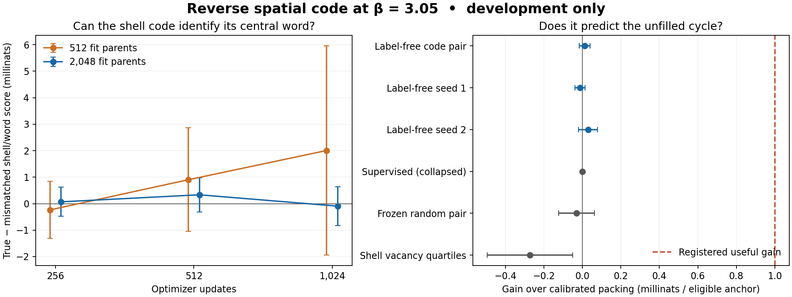

# Does a distant shell predict the unfilled cycle?

**No material gain for this frozen reverse code on development parents.** The hard encoder read only the 386 distant vacancy bits and learned to identify a 12-bit central occupancy word, without cycle labels. Both starts used all four symbols. On 512 held-apart β=3.05 parents, adding the two frozen codes to equally calibrated packing improved the named cycle's log score by **0.0000113 nat/eligible anchor** (paired 95% interval **−0.0000173 to +0.0000399**). The upper end is 4% of the registered 0.001 useful effect. This limits these predictors, not the information in all possible boundary features. No cold assessment, empirical β=0 exam, temperature transfer or physical simulation was opened. No case for cavities here.

| Arm or control | Actual result and consequence |
|---|---|
| Exact ancestry and support | [6,016 disjoint TRAIN parents](lineage.json), no overlap with either the previously exposed exact cycle endpoint or the local trial's reserved roles. Unrelated prior generic training use disclosed. Native learner fit 2,048; 384 **different** parents calibrated hard-code probes; 512 development parents included 31,459 eligible anchors (48.0%) and 93.5% of positives. All 512 retained both outcomes. No anchor-wise error bars. |
| 386-bit supervised raw | [One synthetic plant](raw-stop.json) failed. Raw beat packing by +0.00334 [−0.00194,+0.00863] but lost to stratum by −0.00664 [−0.01343,+0.00015]. The raw physical gain and comparisons against it are **unknown**, not zero. No new plant or fit. |
| Conventional prediction | On development, packing−stratum was **−0.000566 [−0.000945,−0.000186]**. No evidence that this *fitted* packing predictor wins over the local strata. Absolute scores: stratum −0.587869, packing −0.588435, equally recalibrated packing −0.588437, label-free probe −0.588426. [Fit and timing](packing-fit.json) · [runtime equivalence](packing-runtime-check.json). |
| Spatial-information training | [Strong plant recovered](space-control.json). Native [2 parent counts × 2 seeds × 3 checkpoints](learning.csv). Final hard correct-word vs within-stratum different-parent retrieval: **−0.000095 [−0.000828,+0.000638]** nats on 16 independent groups of 32 parents. Detection floor ≈0.00102 for **retrieval**, not cycle prediction. Last update doubling −0.000429 [−0.001139,+0.000281]; extension not triggered. Not a measurement of mutual information. |
| Hard physical probe | Effective 80% detection scale **0.0000408** on development for label-free pair vs equally calibrated packing. The two single-start point gains were −0.0000127 and +0.0000289 nat. H given stratum ≈1.107 and 1.136 nats; their joint code has H given stratum 2.228 nats, **not one two-bit channel**. The within-stratum mismatched-parent contrast was +0.0000168 [−0.0000243,+0.0000579], descriptive conditional on that donor assignment. [All paired contrasts and entropies](probe-dev.json). |
| Matched supervised and random | The same K4 architecture trained using cycle labels passed its own [synthetic control](probe-control.json), then **collapsed to one symbol on both native starts**. Frozen random pair gained −0.0000309 [−0.000123,+0.0000612]; shell density quartiles −0.000273 [−0.000495,−0.0000512]. Nominal K did not equalize achieved rates. |
| β=0, transfer and scaling | [Exact finite-composition null](analytic-hot-null.json): given inventory in the stratum, the shell is independent of the entire central word, hence exactly zero true incremental gain. Not an empirical leakage test. No empirical hot cohort, cold exam, β=2.7111 transfer, K8 or alternate objective: raw admission failed. No global null, temperature-transfer or phase claim. |
| Paid admission | [Amendment](spend-amendment.json): new launches **0**, new spend **$0**, outstanding new exposure **$0**. Existing route cannot bound all-in restarts/storage. Historic observed gross $0.01457995 and prior reservations $1.097052 are separate, not charges for this study. |

[Public study registration](design.json) · [hard encoder hashes](space-freeze.json) · [separate local supervised attempt](../cycle-boundary/disposition.json) · [distinct forward-central HERO study](../hero-central/design.json).
