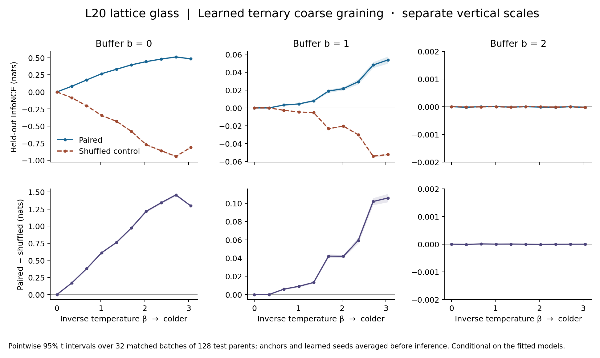
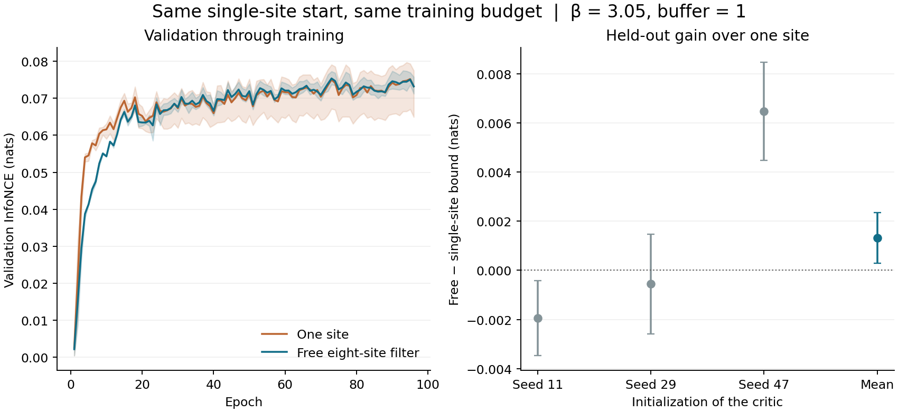

# L20 lattice glass: what did RSMI-NE actually learn?

**A physical signal, but no new collective order parameter in this first pass.** A distant shell predicts something about a 2×2×2 block increasingly well as the system cools. The decisive control is simpler: at β=3.05 a filter that reads one lattice site matches or beats the unrestricted eight-weight filter. In a longer comparison, letting all eight weights adapt never changed the most likely output label on **any of the 6,561 possible blocks**.

[Gökmen et al., PRL 127, Fig. 2b–f](https://arxiv.org/html/2101.11633v3#S0.F2) compared information versus temperature and buffer, optimized versus fixed filters, and the spatial structure of independently learned rules. Their dimer result was compelling because the extracted rule identified a physical operator, not just because an information estimate was positive. We use those diagnostics, and the [companion PRE filter-ensemble analysis](https://arxiv.org/html/2103.16887v2#S3), as a template. These are 3D species/vacancy configurations, not a replication of the dimer phase diagram.



**How far does it reach?** At β=3.05, the random-start learned filter gives a raw held-out InfoNCE bound of **0.4842 nats** with the shell touching the block, **0.0537 [0.0497, 0.0577]** with a one-site buffer, and no positive bound (−0.000026) with a two-site buffer. The β=0 control is near zero. The two-site result does **not** show that the glass lacks longer-range correlations: a variational estimator can miss them. The shell also grows from 56 to 152 to 296 sites, making critic learning harder. The paired-minus-shuffled panels are diagnostics, **not** mutual information estimates; raw held-out bounds can be negative.

**What is the operator?** With one buffer site at β=3.05, the random-start learned score is essentially tied with checkerboard (0.0525) and above uniform composition (0.0080), but **below single-site readout (0.0632)**. The [temperature-wide comparison](comparators.png) and [signed filter slices, overlaps and stability](filters.png) show why looking only at the neural filters is misleading. The [five fixed-pattern controls and spatial correlator](cold-operators.png) include single-site, axis-stripe and face-parity competitors at the cold endpoint. When the cold learned filter (seed 11, buffer 1) is frozen, its normalized connected category-probability correlation is 0.0333 at separation 2 and 0.000063 ± 0.000206 at separation 4 (one parent jackknife SE). This ordinary two-point statistic is not a point-to-set length.



**Could the free filter simply have been harder to train?** We followed up *after* seeing the first grid. At β=3.05, buffer 1, both models now start with identical single-site logits, fit separate matched critics and get **96 epochs**. Free: **0.06627**; fixed site: **0.06495** nats. The mean paired advantage is **0.00132 [0.00029, 0.00234]** nats conditional on the fitted seeds; it is negative for two of the three seeds. The interval is across held-out parent batches, not optimizer restarts. Exhaustively enumerating the ternary cubes, all three free filters still return the anchor-site species as their most probable class on **6,561/6,561** inputs, with probability at least **0.9980** in the worst case. The soft probabilities and fitted critics can differ without identifying a different hard operator. This is a sensitivity check on the same test parents, not an independent confirmation.

**Takeaway.** Keep single-site species as the benchmark. Before calling a feature glass-specific, test whether it predicts **isoconfigurational mobility beyond species, coordination and local energy** on disjoint physical parent configurations. A result at a longer separation or in a replica-overlap field would be more informative than training this same one-copy linear filter on more seeds. This experiment does not rule out an operator in a larger block, a nonlinear encoding, or an overlap field.

[Physical follow-up: site propensity on held-out local trajectories](../l20-propensity/README.md). At β=3.05 the minimum swap cost predicts short-time mobility far better than the frozen RSMI filters. The maps, matched random-filter control and independent-sibling measurements are available.

### Data and inference

- [Audited L20 campaign](https://github.com/konradha/lattice-exploration/tree/2975fa6a6fbeb99e6b3f2156b489963f56bfebbe/results/l20-paper): all **163,840 independent endpoints** at ten β from 0 to 3.05; the released doubled-depth cohort at β=2.7111. Separately per β: **10,240 train / 2,048 validation / 4,096 test** parents. Every periodic anchor stays with its parent. Each training epoch samples new positions; validation has two fixed anchors, test four. No pooling temperatures or using physical descendants as independent examples.
- One *discrete* three-state hidden variable: softmax probabilities from the branch’s `Conv3DSingle` applied to full three-way one-hot labels. Sum the InfoNCE objective exactly over the three possible hidden draws, with the native separable critic and 128 independent parents per batch. No Gumbel noise or continuous bottleneck at evaluation. Fixed templates have a trainable global scale; learned filters have eight free spatial weights. The same scalar weight per site applies to all three species/vacancy channels.
- 150 grid fits: 10 temperatures × 3 buffers × (3 learned seeds + 2 fixed rules); 9 additional cold fixed controls. **24 epochs**, restore both encoder and critic from the best raw validation epoch. The three cold learned fits at buffers 0 and 1 chose epochs near the cap; these are not proven optima. Six additional matched sensitivity fits are reported separately. The separate [planted-label calibration](planted.json) returned 0.983 nats on held-out parents versus a direct discrete plug-in estimate of 0.991; that control is **not** a glass measurement.
- The shuffle holds the critic and hidden probabilities fixed and averages all nonidentity cyclic shifts of environments within each batch. For comparisons, repeated anchors and learned seeds are averaged *within* each of 32 matched test-parent batches before pointwise t intervals. No across-grid multiplicity correction or independent seed-population interval. A fitted critic’s lower bound is not the exact physical MI. The corpus contains one L only.

### Inspect or reproduce

[Temperature/buffer scores](summary.csv) · [matched comparisons](comparisons.csv) · [cold controls](cold-controls.csv) · [longer comparison and exhaustive hard-map check](site-start.csv) · [spatial correlations](spatial.csv) · [all 165 fit receipts](fit-receipts.zip). Receipts include weights, epoch histories, per-test-batch scores, source SHA-256s and split fingerprints. No raw configurations in Git.

Replot the main panels without training (`numpy`, `matplotlib`, `scipy`, from repo root):

```sh
o=results/l20-first-pass
python -m zipfile -e "$o/fit-receipts.zip" "$o"
python examples/l20_plot.py "$o"
python examples/l20_site_start.py --out "$o/site-start" --summarize
```

To retrain instead, use a **fresh** output directory. On the acquisition host `d=$HOME/datasets/lattice-glass/l20-16384-v1`. Tested locally with Python 3.11, TensorFlow 2.18.1, TFP 0.25.0, tf-keras 2.18.0, numpy 1.26.4, wandb 0.19.11, and an editable install of this branch. No external tracking or cloud compute.

```sh
export CUDA_VISIBLE_DEVICES=-1 WANDB_MODE=disabled OPENBLAS_NUM_THREADS=1 TF_NUM_INTRAOP_THREADS=2 TF_NUM_INTEROP_THREADS=1
o=$(mktemp -d); d=$HOME/datasets/lattice-glass/l20-16384-v1
python examples/l20_experiment.py --data "$d" --out "$o"  # optional disjoint --shard k --shards n
python examples/l20_calibrate.py --data "$d" --out "$o/planted.json"
for s in 11 29 47; do python examples/l20_site_start.py --data "$d" --out "$o/site-start" --seed "$s"; done
python examples/l20_plot.py "$o"
python examples/l20_cold.py --data "$d" --out "$o"
python examples/l20_site_start.py --out "$o/site-start" --summarize
```
