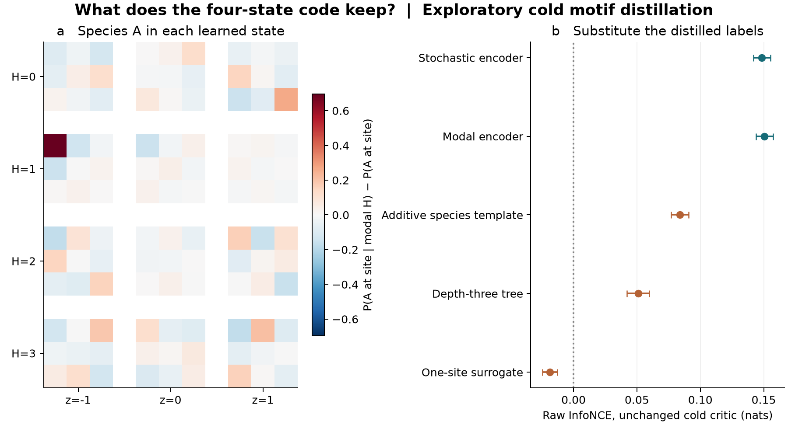
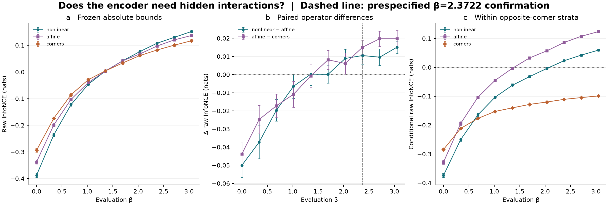
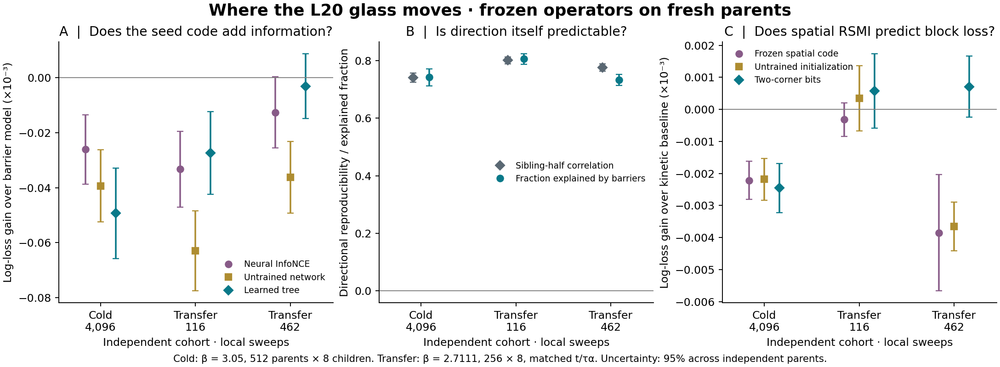

# Two bits in a three-dimensional lattice glass

**A learned four-state variable carries more short-range equilibrium information than the best fixed rule we tested.** At β=3.05 the selected 3×3×3 encoder retained a held-out InfoNCE bound of **0.1521 nats**, versus **0.1173** for the best hand-built two-bit code (species A present or absent at two opposite corners). The paired gain is **0.0348 [0.0314, 0.0381] nats**. Freeze both encoder and critic and the advantage persists at β=2.7111: **0.0293 [0.0247, 0.0339] nats**. These are improvements in a variational bound, not exact differences in physical mutual information.


### What the equilibrium operator actually measures

- **Geometry and controls.** 3³ or 5³ species blocks, one or two empty lattice layers, 150 observed shell sites in every case. The four-state nonlinear network had separate species channels. The search used 12 learned fits (three starts per geometry) and 92 controls/critics. Select the reported geometry and seed on 2,048 validation parents, then score on 4,096 other parents per temperature. All three learned starts beat the best cold-validation-selected fixed code at a one-site buffer, for both block widths. At a two-site buffer no learned fit had a positive raw bound. At β=0 the frozen cold critic performed poorly on positive *and* shuffled examples; the paired-minus-shuffled difference was consistent with zero.
- **Interpretation.** The modal four-state output was 68% recoverable from a distilled species template, versus 45% from one site and 33% by guessing the largest class. Species A at opposite corners matters, but those two bits alone do not achieve the learned bound. On an independent one-anchor distillation evaluation, substituting the hard modal labels for the stochastic labels actually retained the score (0.1506 vs 0.1486 nats with the same critic). After alignment of orientations and labels, independent starts agreed 59–65% of the time. This is a reproducible component, not a unique motif.
- **Range.** For nonoverlapping 3³ blocks the connected cold correlation of the learned probabilities is +0.0246 at centre separation 3 and −0.0161 at 4. The fixed corner rule gives +0.0019 and −0.0003. No evidence here for power-law order, a new thermodynamic phase, or an asymptotic glass order parameter. The [dimer work of Gökmen et al.](https://arxiv.org/html/2101.11633v3#S0.F2) uses the same distinction between optimizing an information bound and independently identifying a physical operator.



### Is the gain just a better linear filter?

No, for the architectures and training budget tested. We trained a matched four-state encoder with **separate affine weights for both independent species indicators at all 27 sites**, using the same training parents, critic architecture, epochs and three starts. Pick each model on cold validation and freeze its encoder and critic. At **β=2.3722**, reserved before scoring this contrast, the nonlinear encoder beats the trained affine encoder by **0.0105 [0.0058, 0.0151] nats** (0.1081 vs 0.0976). At β=3.05 the paired difference is **0.0150 [0.0116, 0.0185]**. This supports a contribution beyond additive weighting under matched training, not the optimality of either parameterization.

On the confirmation temperature the nonlinear code also has a **positive conditional InfoNCE bound of 0.0228 [0.0191, 0.0266] nats**, when every negative shell has the same two corner bits as the positive. That is direct evidence that its association with the environment is not just those bits. It is *not* a subtraction of two variational bounds. The same conclusion holds conditioning on any one of the four body diagonals separately; this does not jointly condition on all eight corners.



Conditioning jointly on **eight A-occupancy bits** still leaves a bound of **0.0177 [0.0155, 0.0199] nats** at β=2.3722. Conditioning instead on the **full eight ternary species** gives **0.00020 [−0.00054, 0.00093]** at the same temperature: 87.5% of positives have no matching negative. The cold-only estimate is positive, but this test cannot establish a transferable signal beyond all eight species. [Per-temperature bounds and exact-match counts](all-corners/all-corners.csv).

**Why we call this local structure:** the term $n_i m_i^2$ in the Hamiltonian couples the occupancies of two distinct neighbors of $i$. Across one buffer layer, a block site and a shell site can both be neighbors of the same buffer site; a single Hamiltonian term can therefore involve both. Across two buffer layers, it cannot. This does not force correlations to vanish at larger distances, but the observed range does **not** require a collective explanation. [Matched bounds](affine/bounds.csv), [paired differences](affine/contrasts.csv), [orientation sensitivity](affine/conditional-diagonals.csv).

[Locked design and controls](protocol.md) · [validation selection](static/selection.json) · [all cold scores](static/scores.csv) · [frozen transfer scores](static/transfer.csv) · [filter agreement](static/reproducibility.csv) · [spatial correlations](static/spatial.csv) · [fit histories and weights](static/fit-receipts.zip). Quoted static intervals use 32 disjoint test-parent batches; they are conditional on fitted networks. More patches from a parent do not increase the independent sample count.

**Reproduce the equilibrium search** from the repository root (`numpy`, `scipy`, `scikit-learn`, `matplotlib`, Python 3.11+), with the released endpoints and sidecar checksums:

```sh
export OPENBLAS_NUM_THREADS=1 OMP_NUM_THREADS=1
r=$(mktemp -d); data=$HOME/datasets/lattice-glass/l20-16384-v1
python examples/l20_operators_static.py --data "$data" --out "$r"
python examples/l20_operators_static_analysis.py --data "$data" --out "$r"
python examples/l20_operators_affine.py --data "$data" --static "$r" --out "$r/affine"
```

### Do the compressed variables predict where the glass moves?



**Not better than the swap barriers at the tested times.** At β=3.05 and 4,096 local sweeps, two sets of four siblings agree on directional motion (correlation **0.740 [0.724, 0.757]** across 512 independent parents). The barrier model explains **0.742 [0.711, 0.770]** of the repeatable directional variance. Adding the learned four-state neural code *worsens* its log score by **0.0000261 [0.0000135, 0.0000387] nats per target**; the tree code does not improve it either. Adding the frozen *equilibrium* code to a separate block-mobility predictor does not help. At β=2.7111, 256 different parents at the matched primary clock of 116 sweeps give the same sign. These are short-time tests, not a measurement at the structural relaxation time.

[Paired model comparisons](directional-comparisons.csv) · [repeatability and explained fraction](repeatability.csv) · [block mobility](block-comparisons.csv) · [six-face contrastive scores](directional-nce.csv) · [lossless observations](acquisition/physical-observations.zip) and [component checksums](acquisition/archive.json). The requested cold secondary at 16,384 sweeps was stopped before a checkpoint existed; it is **not** plotted or scored. All figures here use recorded observations only.
