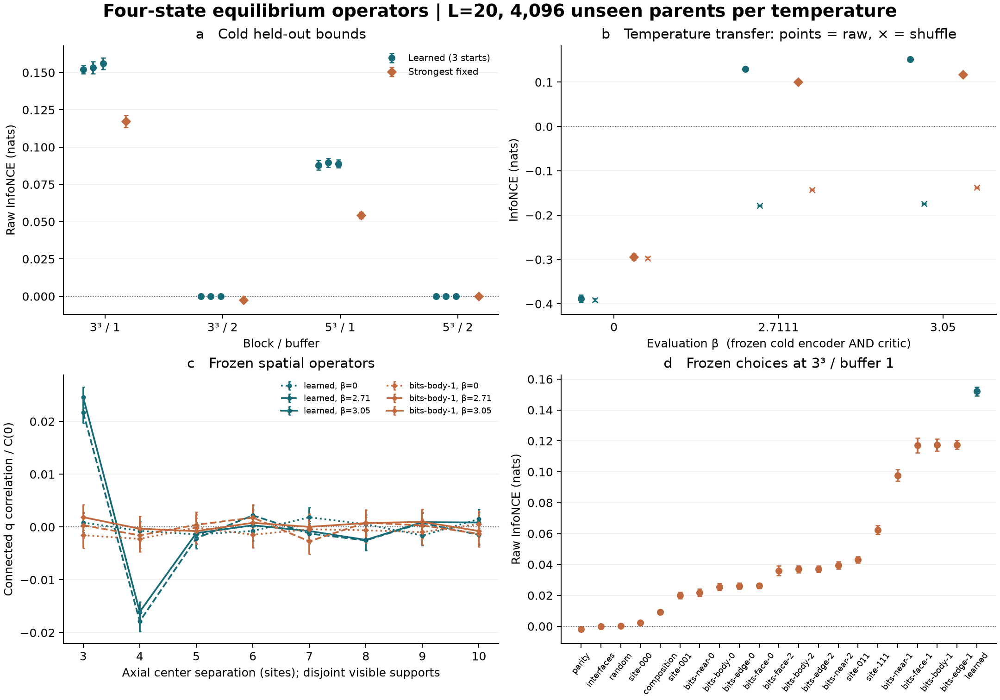

# Two bits in a three-dimensional lattice glass

**A learned four-state variable carries more short-range equilibrium information than the best fixed rule we tested.** At β=3.05 the selected 3×3×3 encoder retained a held-out InfoNCE bound of **0.1521 nats**, versus **0.1173** for the best hand-built two-bit code (species A present or absent at two opposite corners). The paired gain is **0.0348 [0.0314, 0.0381] nats**. Freeze both encoder and critic and the advantage persists at β=2.7111: **0.0293 [0.0247, 0.0339] nats**. These are improvements in a variational bound, not exact differences in physical mutual information.



### What the equilibrium operator actually measures

- **Geometry and controls.** 3³ or 5³ species blocks, one or two empty lattice layers, 150 observed shell sites in every case. The four-state nonlinear network had separate species channels. The search used 12 learned fits (three starts per geometry) and 92 controls/critics. Select the reported geometry and seed on 2,048 validation parents, then score on 4,096 other parents per temperature. All three learned starts beat the best cold-validation-selected fixed code at a one-site buffer, for both block widths. At a two-site buffer no learned fit had a positive raw bound. At β=0 the frozen cold critic performed poorly on positive *and* shuffled examples; the paired-minus-shuffled difference was consistent with zero.
- **Interpretation.** The modal four-state output was 68% recoverable from a distilled species template, versus 45% from one site and 33% by guessing the largest class. Species A at opposite corners matters, but those two bits alone do not achieve the learned bound. On an independent one-anchor distillation evaluation, substituting the hard modal labels for the stochastic labels actually retained the score (0.1506 vs 0.1486 nats with the same critic). After alignment of orientations and labels, independent starts agreed 59–65% of the time. This is a reproducible component, not a unique motif.
- **Range.** For nonoverlapping 3³ blocks the connected cold correlation of the learned probabilities is +0.0246 at centre separation 3 and −0.0161 at 4. The fixed corner rule gives +0.0019 and −0.0003. No evidence here for power-law order, a new thermodynamic phase, or an asymptotic glass order parameter. The [dimer work of Gökmen et al.](https://arxiv.org/html/2101.11633v3#S0.F2) uses the same distinction between optimizing an information bound and independently identifying a physical operator.


[Locked design and controls](protocol.md) · [validation selection](static/selection.json) · [all cold scores](static/scores.csv) · [frozen transfer scores](static/transfer.csv) · [filter agreement](static/reproducibility.csv) · [spatial correlations](static/spatial.csv) · [fit histories and weights](static/fit-receipts.zip). Quoted static intervals use 32 disjoint test-parent batches; they are conditional on fitted networks. More patches from a parent do not increase the independent sample count.

**Reproduce the equilibrium search** from the repository root (`numpy`, `scipy`, `scikit-learn`, `matplotlib`, Python 3.11+), with the released endpoints and sidecar checksums:

```sh
export OPENBLAS_NUM_THREADS=1 OMP_NUM_THREADS=1
r=$(mktemp -d); data=$HOME/datasets/lattice-glass/l20-16384-v1
python examples/l20_operators_static.py --data "$data" --out "$r"
python examples/l20_operators_static_analysis.py --data "$data" --out "$r"
```
