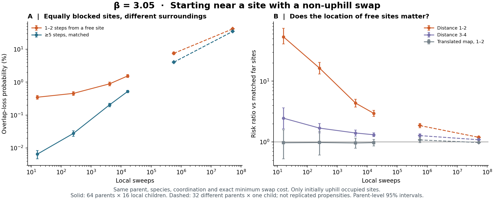
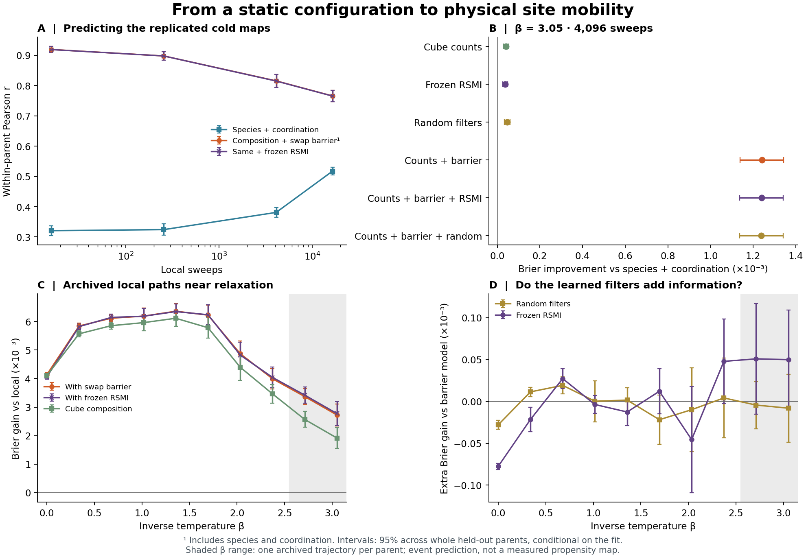
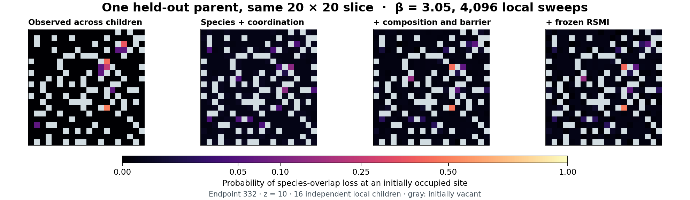

# What predicts where the L20 glass will relax?

**Where a site starts matters even at fixed local energy and barrier.** At β=3.05 and 4,096 physical sweeps, an initially uphill site 1–2 lattice steps from a site with a non-uphill swap lost its original species **0.888%** of the time, versus **0.204%** for sites ≥5 steps away in the same configuration, matched on species, coordination and exact minimum swap cost. That's **4.36× [3.74, 5.06]**, averaged across 64 independent configurations, each evolved with 16 independent physical children. Translating the free-site map gives **0.96× [0.79, 1.16]**. Matching retained 98.1% of near sites.



The association is still visible close to structural relaxation: at **52.37M** local sweeps the matched risks are **41.59% vs 34.84%**, a **6.75 percentage-point** difference [4.91, 8.60]. These long paths came from 32 *other* parents with only one child each. They establish an ensemble association, not reliable long-time propensity maps for individual parents. A static proximity association is consistent with [Nishikawa & Berthier’s facilitation picture, Fig. 3](https://arxiv.org/html/2307.08110v2#S0.F3); it neither proves that one mobile cluster caused the loss nor discovers a new order parameter.

**Did RSMI discover this signal? No evidence that these filters did.** On the 32 held-out cold parents at 4,096 sweeps, correlation with observed site propensity was **0.381** for species + coordination, **0.402** after adding frozen RSMI alone, and **0.406** after adding matched *random* filters instead. The change that mattered was adding the actual minimum swap cost: **0.816**, without any learned representation. The two independent eight-child propensity maps themselves correlated at **0.829**; this is a reproducibility diagnostic, not a bound on the correlation against the 16-child mean.



The proper probability score gives the same verdict. Adding the barrier and cube counts cuts held-out Brier loss from **0.005331 to 0.004089**. Adding RSMI on top changes it to **0.004092**: paired improvement **−0.0000021** [−0.0000045, +0.0000003]. At 52.37M sweeps the corresponding improvement over the barrier baseline is **+0.000050** [−0.000009, +0.000109] on 16 held-out, single-child parents. The positive short-time structure–mobility link is strong; neither the increment unique to these filters nor a new long-time collective operator is established. Higher-order barrier geometry is not matched by the proximity comparison.



## What was measured

For each initially occupied site, count the fraction of independent **local** trajectories in which that site is empty or has the other species at lag *t*. This is the loss of the site overlap in [Nishikawa & Berthier, Eq. 2](https://arxiv.org/html/2307.08110v2#S0.E2), before subtracting its random baseline. A return to the initial species is not a loss. It measures neither tagged-particle displacement nor first escape. Nonlocal sweeps supplied equilibrium **origins**, never dynamical labels.

- **New cold experiment.** At β=3.05 draw 64 fresh production parents without replacement from the static encoder's untrained, unvalidated test partition. Fork 16 independent physical RNG streams from each identical initial lattice. Save all 1,024 trajectories at 16, 256, 4,096 (primary comparison) and 16,384 local sweeps. Record origin identifiers, child stream keys, energies, cumulative accepts and hashes. These are short-time propensities, not measurements at the cold relaxation time (~65.8M sweeps).
- **Original trajectories.** Ten temperatures, 32 candidate-age parents per β, except 64 from the doubled-depth β=2.7111 release. Select the saved lag nearest in log time to the previously measured relaxation time and to 1% of it; use one sweep when the crossing predates the first snapshot. All 19 cohort–lag mean overlaps reproduce the [campaign table](https://github.com/konradha/lattice-exploration/blob/2975fa6a6fbeb99e6b3f2156b489963f56bfebbe/results/l20-paper/dynamics_lags.csv) to roundoff. At β=2.7111 and 3.05 the archive has **one child per parent**: these rows test prediction of events, not replicated site propensities. Replica counts vary with β; raw correlations are not directly comparable across temperatures.
- **Prediction.** Per cohort, fix half the parents for fitting and half for scoring, keeping every child, lag and site of a parent together. Only the initial configuration supplies features. Species × occupied-neighbor count is a saturated 14-cell baseline; on-site energy adds no independent variable because it is exactly $(m_i-\ell_{\sigma_i})^2$. Add conventional cube composition (means and spreads), then the exact minimum cost of any unlike nearest-neighbor swap, the physical barrier in [Fig. 3a](https://arxiv.org/html/2307.08110v2#S0.F3). The fit receipts also report the barrier without cube composition. Each larger model fits the residual of the same saturated baseline with the same fixed depth-3 boosted-tree settings.
- **Learned vs unlearned.** Freeze all three [buffer-one cold encoders](../l20-first-pass/README.md); never tune the encoder on mobility. Add their soft species probabilities, averaging over 48 cubic symmetries and all eight incident cubes. Random controls use three untrained kernels with the same norms, symmetries, support and downstream model. To avoid even unsupervised parent overlap, use the β=3.05 filters on other archive temperatures, the β=2.7111 filters on the original β=3.05 archive, and the β=3.05 filters on the new cold test parents. A separate control permutes full predictions within each test parent's species × coordination strata. That destroys barrier information too: it is not an RSMI-only shuffle.
- **Scoring.** The Brier score is per physical child: for predicted probability $p$ and observed sibling fraction $q$, average $(p-q)^2+q(1-q)$ over occupied sites. An improvement is a **decrease** in this score. Intervals for model differences use paired whole held-out parents, conditional on the fitted models. Report within-parent Pearson correlations and the independent-sibling split-half correlation separately. Intervals across β and lag are pointwise, not a multiplicity-adjusted discovery scan. Only L=20 and this representation are tested.
- **Signal scale.** The covariance across sites between two disjoint eight-sibling propensity maps estimates the variance in the true spatial propensity of a cold parent without counting finite-replica shot noise. [`cold-scale.csv`](cold-scale.csv) expresses a difference in Brier scores as a percentage of that variance. Both these ratios and the matched near/far risk ratios use 10,000 paired whole-parent bootstrap draws.
- **Proximity test.** Independently of model fitting, compare initially occupied sites which have *no* non-uphill swap themselves. In each parent, compare sites 1–2 steps from the nearest site with a non-uphill swap against sites ≥5 steps away, matching exactly on species, coordination and minimum swap cost. Use toroidal Manhattan distance; include both endpoints of a free bond even if one is a vacancy. Weight far-site strata to the near-site population, retain near strata with at least eight far sites, then give each parent equal weight. Repeat with the entire free-site map shifted by half a box in all axes; this preserves its clustering but breaks its registration to the trajectories. This is an association, not a causal intervention.

## Data and reproduction

[Compact analysis inputs](inputs.zip) · [raw new cold local checkpoints](cold-trajectories.zip) · [per-parent scores, split IDs, calibration and model settings](scores.zip) · [performance and paired intervals](performance.csv) · [cold gains relative to reproducible spatial variance](cold-scale.csv) · [matched site risks](proximity.csv) and [parent rows](proximity-parents.csv). [Archive lineage](archive-provenance.json) · [new fork lineage](cold-provenance.json). No paid compute used for this analysis.

Replot from the committed files with NumPy, SciPy, pandas and Matplotlib, from repo root:

```sh
o=results/l20-propensity
python -m zipfile -e "$o/scores.zip" "$o/scores"
python examples/l20_propensity_plot.py "$o"
```

Refit on the published trajectories without the simulator, TensorFlow or a GPU (also requires scikit-learn and threadpoolctl):

```sh
w=$(mktemp -d); python -m zipfile -e "$o/inputs.zip" "$w/inputs"
export OPENBLAS_NUM_THREADS=1 OMP_NUM_THREADS=1
for f in "$w"/inputs/*.npz; do
  python examples/l20_propensity_predict.py --input "$f" --fits results/l20-first-pass/fit-receipts.zip --out "$w/scores"
done
python examples/l20_propensity_proximity.py --inputs "$w/inputs/cold-replicated.npz" "$w/inputs/archive-09.npz" --out "$w/proximity-parents.csv"
```

To regenerate the cold forks rather than use the snapshots, point `examples/l20_propensity_forks.py --help` at the checksum-verified endpoint release and the CPU backend of [lattice-exploration at the acquisition commit](https://github.com/konradha/lattice-exploration/tree/2975fa6a6fbeb99e6b3f2156b489963f56bfebbe). `examples/l20_propensity_archives.py --help` reconstructs the other ten inputs from the corresponding campaign checkpoints. Each score input is bound to its SHA-256 in its fit receipt.
