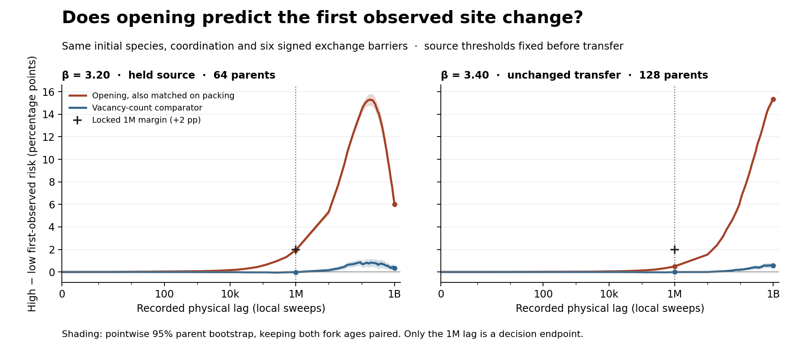

# Can nearby moves open an initially immobile site?

**An opening predicts a first observed state change even when all six incident barriers match. The direction transfers from β=3.20 to β=3.40; the registered two-percentage-point effect does not.** This is an association across sites in archived configurations, not a measurement of cage lifetime or the causal effect of forcing a particular swap.

## What was measured

For an initially occupied site, **h** is the probability that one native physical proposal immediately changes its species, including a change to vacancy. **O** weights each possible *nonincident* accepted swap by the positive change it would cause in that site's total h. The full difference of six incident rates is taken before the positive part. The [derivation, native proposal law, cutoff, and complete dependency stencil](oracle-method.md) show why an update need not touch the site's nearest neighbors to matter. In qualification, a shorter stencil would have missed 1,123 contributing site/proposal pairs; subtracting rounded rates would have erased 63 positive increments. [Independent brute-force receipt](oracle-qualification.json).

**Populations:** the descriptive census targets the complete amended L20 release: ten temperatures, 16,384 distinct parents each, 6,000 occupied centers per parent. The β=2.7111 archive is the deeper replacement, not a pooled sample. Fixed feature tallies only for the 40,960 reserved rows; no reserve trajectories, frozen-cavity targets, training, or per-parent archive output for those rows. [Input hashes and split](inputs.json) · [live/terminal census receipt](status.json) · [design](design.md). The β=3.20 and 3.40 physical parents are *separate*, not trajectories invented for the bulk release.

## Held parent test: first observed change by 1,000,000 local sweeps

The outcome is the first sampled mismatch to the site's own initial species, including vacancy; an observed return does not erase an earlier mismatch. No sampled mismatch by the last checkpoint is right-censored. An unobserved change and return between checkpoints is not detectable. The original 300M and 500M fork ages stay paired. High/low opening thresholds were computed only on 48 independent β=3.20 FIT parents with no later checkpoint used, then frozen. Both contrasts below match exactly on species, coordination and the multiset of all six signed incident barriers (including same species); measured within-stratum range of h was zero. The adjusted contrast also matches ordinary packing. Percentages refer to matched sites; the estimand is not the risk difference for all occupied sites.

| Cohort | Paired parents | Matched low → high risk, packing-adjusted | Difference, 95% parent CI | Eligible sites matched |
|---|---:|---:|---:|---:|
| β=3.20, held source | 64/64 | 1.506% → 3.449% | +1.943 pp [1.831, 2.056] | 53.67% |
| β=3.40, unchanged transfer | 128/128 | 0.685% → 1.181% | +0.496 pp [0.455, 0.538] | 56.79% |

Without the additional packing match the differences were +2.085 pp [1.968, 2.201] and +0.529 pp [0.484, 0.575]. The conventional comparator based on distance-two vacancy count gave −0.013 pp [−0.111, 0.084] and −0.008 pp [−0.047, 0.033]. All intervals resample independent parents, not sites, ages, siblings, or checkpoints. **The colder absolute effect is small, not zero:** the source interval straddles the margin; the target interval lies well below it. The matched risks above also show why a positive relative difference does not imply a two-point absolute improvement.

[Physical protocol](history/protocol.json) · [frozen cuts](history/fit-lock.json) · [held-source plot](history/held-source.png) · [transfer plot](history/transfer.png) · [parent-clustered decision](history/transfer-decision.json) · [83-lag curves](history/transfer-curves.csv). Observing only the decimated grid lowers the packing-adjusted risk differences to +1.770 and +0.440 pp; comparisons are schedule-specific. On the full grid, at β=3.40, 548,557 sites across the two fork ages were observed returning after a mismatch and 895,288 had no observed mismatch through 1B local sweeps. The site counts describe coverage, not independent draws.



**The horizon matters.** At the terminal 1B checkpoint, the same pack-matched β=3.40 sites had cumulative first-observed risks of 29.77% versus 45.12%: **+15.35 pp [15.09, 15.62]**. The β=3.20 terminal difference was +6.00 pp [5.54, 6.49]. These are descriptive contrasts from the prespecified full curves, with pointwise intervals, not simultaneous tests or a replacement for the 1M decision. The results support an initial environmental-opening propensity on long timescales, not proof of mediation by the particular one-step neighbor move. [Figure data](history/contrast-over-time.csv).

The [separate cold-origin census](history/cold-origin-census.json) covers 512 forks from 256 independent preparations. The [warmer secondary](history/warm-secondary.png) uses only the 271 eligible linked parents (5,664 forks); 81 reserve parents and all 2,080 corresponding forks were excluded. Its endpoint is the common sampling-grid terminal *within each beta*, which ranges from 1,024 to 524,288 sweeps, so it is not a fixed-time temperature trend. [Warm support and parent intervals](history/warm-secondary.json) · [history reproduction order](history/reproduction.json).

## Numerical decision

The stock CPU InfoNCE routine on synthetic batch-48 logits with a known diagonal signal returned **4.0 nats**, above ln(48)=3.871201; the row-shifted float64 result on the *same* logits was 3.871196. Of 234 eager/graph controls, 70 scalar checks and 22 one-step Adam agreement checks failed. All tested gradients/Adam states were finite. The historical failing tensors were not saved, so that mechanism is sufficient but not proven to have caused those two earlier failures. **No stock predictive comparison, GPU allocation, library patch, or new physical simulation.** [Numerical report and plot](numerics/report.md) · [machine-readable controls](numerics/decision.json).

## Reproduce the census

Use local paths to the verified `lattice-exploration` release and a scratch directory. Run from the root of this stock fork. The input stage reconciles the immutable 50:50 split; oracle and histories run independently of the aggregate report.

```sh
export OPENBLAS_NUM_THREADS=1 OMP_NUM_THREADS=1 MKL_NUM_THREADS=1
python3 examples/opening_inputs.py "$EXPLORATION/runs" "$STAGED"
# Build and qualify the Linux C++17 oracle as in oracle-method.md.
python3 examples/opening_census.py "$STAGED" /tmp/opening_oracle.so results/opening-mechanism/oracle-qualification.json --workers 7
python3 examples/opening_census_report.py "$STAGED"
```

Local shards are atomic and resumable with pinned binary, input, receipt and source checksums. Each contains per-parent sparse joint distributions except that the sealed reserve contributes group tallies only. The parent identity for any non-reserve row is recovered by beta and native row in the pinned input. Never pool sites to estimate sample precision. [Numerical reproduction](numerics/report.md#reproduction).
