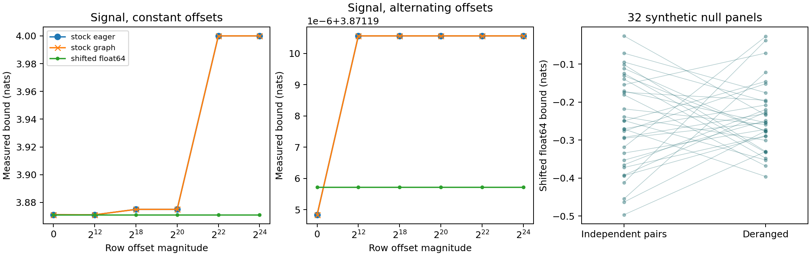

# Batch-48 stock InfoNCE: numerical gate **NO-GO**

An impossible historical scalar is documented. The same value is reproducible on synthetic logits through the unmodified stock loss, **without** overflowing an exponential or producing a nonfinite gradient. That establishes a sufficient numerical mechanism, not what happened inside the two historical fits. No historical fit was retried; no predictive fit or library change was made.

### Retained observations (natural-log units)

| Prior displaced control | Rejected stock scalar | Cap `ln(48)` | Adam iteration | Accepted range before rejection |
|---|---:|---:|---:|---:|
| 6102 | 4.0 | 3.87120101 | 718 | [−2, 2] |
| 6103 | 4.0 | 3.87120101 | 1,023 | [−2, 2] |

The worker compared the unrounded scalar **after** `apply_gradients`; the scalar was computed on the pre-update forward pass. The accepted range excludes the rejected scalar. [Scientific records](worker-evidence.json) give the source digests, both failures and all six arms' retained first/progress observations. Periodic progress entries are observations, not final step counts. None of the 24 scheduled portable checkpoint paths exists. There is no failing critic-score matrix, gradient, network state or Adam moment in these records. Initial inputs or a matching seed do not restore that state. We cannot evaluate the reference on the two historical matrices or establish the finiteness of the historical updates.

### Same-logit CPU experiment

We evaluated **117 matrices**, once eager and once under `tf.function`, using the actual stock diagonal-mask wrapper and TFP 0.25.0. The float64 reference starts from the **already materialized float32 scores**, subtracts each row maximum, and averages `ln(48) + z[i,i] − log(sum(exp(z[i,:])))`. Keeping the subtraction inside each row avoids subtracting two large, separately reduced means. The reference passed every frozen check, including invariance under shifts that preserved score differences.

| Fixture (graph mode) | Row offsets | Stock (nats) | Shifted float64 (nats) |
|---|---|---:|---:|
| All equal | none | 0.00000024 | < 1e−15 in magnitude |
| Exact `+16` diagonal | none | 3.87119484 | 3.87119572 |
| Same signal, deranged columns | none | −12.12880516 | −12.12880428 |
| Same signal | constant `+2²²` | **4.0** | **3.87119572** |
| Same signal | alternating `±2²²` | 3.87120056 | 3.87119572 |

At `+2²²` the signal and all within-row differences are exactly representable: loss of contrast **in the input** cannot explain that 4.0. TFP computes `mean(positive) − (mean(row_logsumexp) − ln(48))` in score dtype. The log-sum-exp itself uses a stable kernel; the surrounding reductions and large-offset subtractions need not preserve a small residual. Input rounding is a distinct issue: in 8 of the 234 runtime cases float32 offsets changed within-row differences, moving the corresponding reference by up to 0.08032 nats; a downstream stable reporter cannot restore lost input precision.

Across 32 independent Rademacher-pair panels, the mean reference was −0.25614 nats; after cyclic derangement, −0.24052. The paired difference averaged −0.01563 (panel SD 0.16506). A fixed nonconstant critic of independent pairs need not estimate exactly zero; the all-equal-logit control supplies the exact zero target. These are arithmetic fixtures, not evidence of glass dynamics.

### Scalar, gradient and update are different tests

| Locked criterion | Failed / 234 runtime cases |
|---|---:|
| Shifted float64 reference | 0 |
| Stock scalar, bound and agreement | **70** (8 above the cap tolerance; 4 exactly 4.0) |
| Stock score gradient, finiteness and agreement | 0 |
| Post-update residual and Adam state, finiteness and agreement | **22** (all finite; updated residual disagreed) |

For each matrix the optimized diagnostic variable was a free zero-initialized score residual. We differentiated the negative stock bound, took one real `tf.keras.optimizers.Adam(.009)` step and inspected the residual, iteration and both moments; each case started afresh. The comparator fed the analytic float64 `(softmax − identity)/48` gradient, cast to float32, into the same Adam optimizer. Maximum score-gradient discrepancy was `3.44e−9` (rounded up). The maximum moment discrepancies were `4.66e−10` and `1.43e−13` (rounded up). Yet the near-saturated diagonal `+16` signal had an updated-residual error of `9.1093e−6`, exceeding the prespecified `1e−6` criterion even **without** row offsets. This is a finite one-step disagreement, not evidence that a historical optimizer diverged. These tests do not inspect the chain rule through historical encoder/critic weights, or cumulative Adam state.

**Decision:** the unmodified stock arithmetic fails its numerical gate, independently of physical transfer. Stable reporting alone neither validates the training update nor explains away an earlier guard rejection. Do not proceed to a stock comparison on this evidence. Any proposed library change would require separate review, not bypassing the bound guard.

### Reproduction

[Lock](lock.json) · [all measured values](controls.csv) · [machine-readable decision and source hashes](decision.json) · [script](../../../examples/opening_numerics.py). Run `PYTHONDONTWRITEBYTECODE=1 PYTHONPATH=. python examples/opening_numerics.py` from the repository root in the stock Python 3.11 environment (TensorFlow 2.18.1, TensorFlow Probability 0.25.0, tf-keras 2.18.0, NumPy 1.26.4). The script selects CPU, uses the stock loss without modifying it, reads only enumerated historical worker records, and writes only this result directory. CSV rows are executions, not independent replicates; graph/eager cases use the same synthetic matrices.
